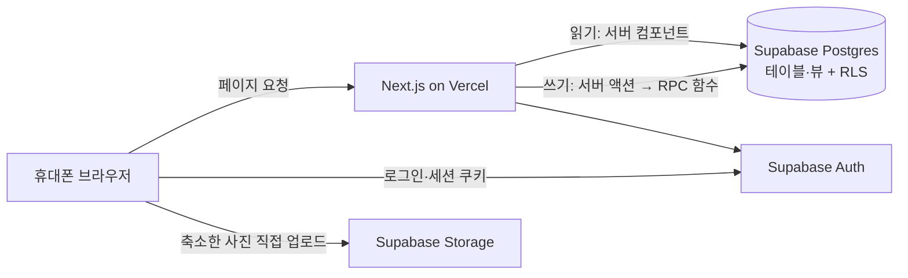
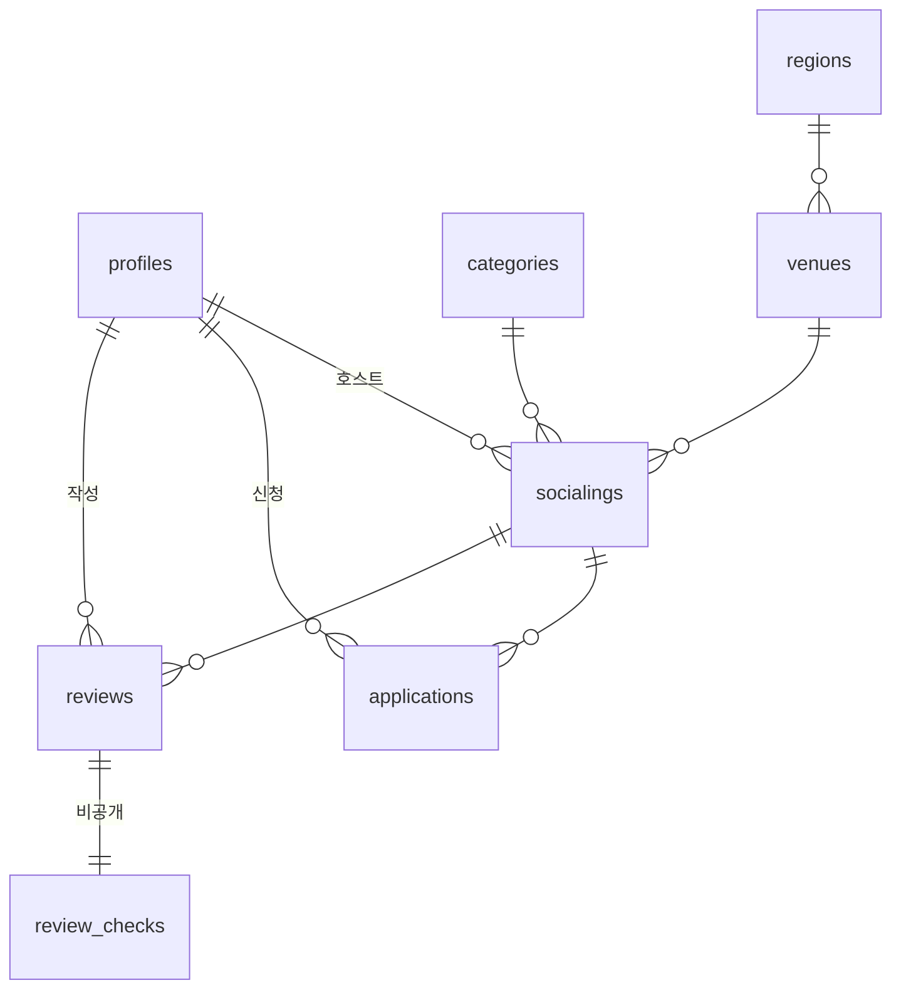

# 아키텍처: 어떻게 만드나

- 무엇을 만드는지는 [spec.md](spec.md), 결정 이유는 [decisions.md](decisions.md). 구조가 바뀌면 같은 PR에서 이 문서를 고친다.
- 버전은 2026-10-12에 npm에서 확인한 값이다. MS1에서 설치할 때 다시 확인하고, 최신 메이저가 막 나온 경우 한 단계 이전 안정 버전을 고정한다.

## 1. 스택

| 영역 | 선택 | 버전 |
|---|---|---|
| 프레임워크 | Next.js App Router + React | next 16.3.x (16.4는 쓰지 않음), react 19.x |
| 언어 | TypeScript | 6.0.x (7.0 쓰지 않음) |
| DB·인증·파일 | Supabase (Postgres, Auth, Storage). 키는 새 방식 publishable·secret만 | @supabase/supabase-js 2.x, @supabase/ssr 0.12.x, supabase CLI 2.x (`npx supabase`) |
| UI | Tailwind CSS + shadcn/ui, 아이콘 lucide-react. 창(바텀시트·가운데 창)은 Radix Dialog에 DESIGN 토큰을 직접 입힌다(decisions.md) | tailwindcss 4.x, shadcn CLI 4.x, @radix-ui/react-dialog 1.1.x |
| 글꼴 | Noto Sans KR. npm 글꼴 패키지로 앱 안에서 제공 (`next/font/google`은 빌드 때 Google에 접속하는데 클라우드 환경 네트워크가 막을 수 있음) | @fontsource-variable/noto-sans-kr 5.3.x |
| 입력 검증 | zod | 4.x |
| 린트 | ESLint + eslint-config-next (core-web-vitals, typescript) | eslint 9.x (10 쓰지 않음) |
| E2E 테스트 | Playwright (Chromium, 모바일 390px) | @playwright/test 1.56.1 (클라우드 환경의 Chromium에 맞춰 고정) |
| 이미지 축소 | browser-image-compression (문제 시 canvas로 대체) | 2.0.2 |
| 배포 | Vercel Hobby | - |

## 2. 구조



- **읽기**: 서버 컴포넌트가 Supabase에서 바로 읽는다. 비로그인도 목록·상세·피드를 읽을 수 있게 RLS를 연다. 동적 페이지가 기본이다.
- **쓰기**: 버튼 하나 = 서버 액션 하나 = Postgres 함수(RPC) 하나. 상태 전환·권한·정원 검사는 **DB 함수 안에만** 둔다. 서버 액션은 입력을 zod로 검사하고 함수를 부른 뒤, 결과를 화면 문구로 바꾸고 관련 경로를 재검증(revalidate)한다.
- **사진**: 브라우저에서 1MB 이하로 축소 → Storage에 직접 업로드(`사용자id/파일명`) → 경로를 함수에 넘긴다. 업로드가 실패하면 경로 없이 제출한다(Q4).
  - SP3에서 정한 것: `components/photo-picker.tsx`가 사진을 고르는 즉시 줄여서 올리고, 올린 경로를 onChange로 넘긴다(실패하거나 지우면 null. `name`을 주면 폼의 숨은 칸으로도). 후기 쓰기(P09)는 올리는 동안 "후기 올리기"를 잠근다(onUploadingChange). 줄이기는 `lib/photos/compress.ts`: 긴 변 1600px, 목표 0.9MB, JPEG로 저장(버킷 한도 1MB에 여유). 라이브러리의 웹 워커는 외부 CDN(jsdelivr)에서 코드를 받아 와서 쓰지 않는다(`useWebWorker: false`).
  - 파일 고르기는 `accept="image/*"`. iPhone은 이때 HEIC 사진을 JPEG로 바꿔 넘긴다. 브라우저가 열지 못하는 형식(예: Android Chrome의 HEIC)은 "사진을 올리지 못했어요" + "JPEG로 골라 주세요".
  - 경로는 `<사용자 id>/<무작위 uuid>.jpg`. 고른 뒤 제출하지 않고 나간 사진은 버킷에 남는다(MVP에서는 정리하지 않음). `npm run seed`가 두 버킷을 비운다.
- **시간**: 현재/지난, 신청 가능, 버튼 가능 여부는 조회할 때 `now()`로 계산한다. 예약 작업(cron)은 없다. DB는 `timestamptz`, 화면 표시와 날짜 필터 계산은 Asia/Seoul로 고정한다(서버가 UTC여도 같은 결과).
- **세션**: `@supabase/ssr`로 쿠키 세션. Next.js 16은 루트 `proxy.ts`(예전 이름 middleware)에서 `supabase.auth.getClaims()`로 세션을 갱신하고, 로그인이 필요한 경로는 `/login?next=원래주소`로 보낸다. 서버 코드에서 `getSession()` 결과는 믿지 않고 `getClaims()`로 확인한다(Supabase 공식 Next.js 가이드, 2026-10-12 판).
  - SP1에서 정한 것: 세션 갱신과 주소 처리는 `lib/supabase/proxy.ts`(`updateSession`), 서버 컴포넌트·서버 액션용 클라이언트는 `lib/supabase/server.ts`. 로그인이 필요한 주소 목록(P06 `/me`, P07, P08, P09, P11)과 `next` 검사는 `lib/routes.ts` 한 곳에 둔다. 로그인한 사람이 `/login`·`/signup`에 오면 proxy가 `next`(없으면 `/`)로 보낸다.
  - proxy는 첫 관문일 뿐이라 로그인이 필요한 화면과 서버 액션도 `getClaims()`로 다시 확인한다(Next.js 16 proxy 안내). 호스트인지 같은 권한은 화면과 DB 함수가 확인한다.
  - `next`는 `/`로 시작하고 `//`·`/\`로 시작하지 않으며, URL로 풀었을 때 앱 주소 그대로인 값만 받는다(탭·줄바꿈이 섞여 다른 사이트로 읽히는 주소도 거부).
  - 가입은 `auth.signUp`에 `options.data.nickname`을 넘기고, profiles 행은 가입 트리거가 만든다. 닉네임 중복은 가입 전에 profiles를 읽어 확인하고, 그 사이 같은 닉네임이 먼저 가입하면 트리거가 실패하므로 한 번 더 읽어 "이미 쓰는 닉네임이에요"로 바꾼다.
  - 로그아웃은 이 기기의 세션만 끝낸다(`signOut({ scope: "local" })`). 발표 중 같은 계정으로 연 다른 기기는 그대로다.

## 3. 데이터 모델

### 3.1 테이블

| 테이블 | 주요 컬럼 | 제약·메모 |
|---|---|---|
| `profiles` | id(= auth.users.id), nickname, role(`member`/`host`/`admin`, 기본 `member`, 지금은 `member`만 씀. 호스트인지는 `socialings.host_id`로 판단), created_at | nickname 2~12자, unique. 가입 시 트리거로 생성(닉네임은 가입 메타데이터에서) |
| `regions` | id, sido, sigungu, code | 시드. 전국 시·도 > 시·군·구 |
| `venues` | id, type(`branch`/`external`), name, region_id, address_text | 지점도 region_id를 가진다 |
| `categories` | id, slug, name, sort_order, is_party | 5개 고정 시드. slug: `learning`, `hobby`, `activity`, `culture`, `party` |
| `socialings` | id, host_id, title, description, category_id, has_alcohol, venue_id, starts_at, apply_deadline_at, fee, capacity, staff_count, join_type(`first_come`/`approval`), approval_criteria(null 가능), cover_photo_path(null 가능), status(`recruiting`/`confirmed`/`completed`/`canceled`, 기본 `recruiting`), confirmed_at, completed_at, canceled_at, created_at, updated_at | apply_deadline_at ≤ starts_at, capacity 2~20, fee ≥ 0, staff_count ≥ 0 |
| `applications` | id, socialing_id, user_id, status(`pending`/`accepted`/`rejected`/`canceled`), created_at, decided_at, canceled_at | (socialing_id, user_id)는 status가 pending·accepted인 행이 하나만 (부분 유니크 인덱스) |
| `reviews` | id, socialing_id, user_id, body, photo_path(null 가능), created_at | (socialing_id, user_id) 유니크, body 10~500자 |
| `review_checks` | review_id(PK, FK), members_match, extra_money, content_match (boolean) | **직접 SELECT 정책 없음**. 집계 함수만 읽는다 |

enum 이름과 값은 위와 같다. 코드의 타입은 `supabase gen types`로 만든다.



### 3.2 계산 값 (저장하지 않음, 뷰나 함수로)

| 이름 | 정의 |
|---|---|
| 참여 확정 인원 | 그 소셜링의 `accepted` 신청 수 |
| 신청 가능 | status ∈ (recruiting, confirmed) AND now() < apply_deadline_at AND 참여 확정 인원 < capacity |
| 꼬리표 | 신청 마감 일시 지남 → "신청 마감", 아니고 정원 참 → "정원 마감" (종료·호스트 취소에는 없음) |
| 현재 / 지난 | starts_at > now() / 그 외 |
| 호스트 기록 | 최근 6개월(starts_at 기준): 열린 소셜링 수(completed + accepted 1명 이상), 호스트 취소 수(canceled 중 pending·accepted 신청이 있던 것), 소개 일치 비율(review_checks 중 members_match = true, extra_money = false, content_match = true 비율, 응답 5건 이상일 때만), 후기 수 |
| 새 호스트 / 등급 | 열린 소셜링 3회 미만 → 새 호스트. 5회 이상 + 호스트 취소 0 + 일치 90% 이상 → "믿고 가는 호스트" |

호스트 기록은 SECURITY DEFINER 함수 `get_host_record(p_host_id)`가 집계값만 돌려준다(MS6). 칸: `opened_count`, `canceled_count`, `review_count`, `response_count`(비공개 응답 수), `match_rate`(0~1, 반올림 안 함, 응답 5건 미만이면 null), `is_new_host`, `is_trusted_host`(MS8 기준 공개 등급. 반올림 전 비율로 판단하고, 비율이 없으면 false). "최근 6개월"은 소셜링 일시가 6개월 전 이후인 소셜링(앞으로 열릴 소셜링 포함)이고, 시드 쪽 `hostRecordFromSeed`와 같은 규칙이다. 비로그인도 부를 수 있다. 개별 응답은 어떤 경로로도 나가지 않는다.

목록·상세는 뷰 `socialing_summaries` 하나를 읽는다(MS2). 소셜링 칸에 호스트 닉네임·카테고리·장소·지역을 붙이고, 위 표를 계산한 칸을 더한다.

| 칸 | 값 |
|---|---|
| `accepted_count` | 참여 확정 인원 |
| `is_past` | 지난 소셜링 (starts_at <= now()) |
| `can_apply` | 신청 가능 |
| `status_tag` | 꼬리표 `closed`(신청 마감) / `full`(정원 마감) / null |
| `closed_reason` | 신청할 수 없는 이유. spec 8.4의 2·13줄 순서로 `host_canceled` / `started`(소셜링 일시 지남) / `not_open`(종료) / `deadline` / `full`, 신청 가능하면 null |

탐색 필터(MS6, spec M3)는 DB가 아니라 `lib/explore-filter.ts`가 거른다. P01 서버 컴포넌트가 현재 소셜링(`listExploreSocialings`: 카드 칸 + `venue_id`·`category_is_party`·`region_sido`)과 필터 목록(`getFilterCatalog`: 카테고리·스터디지점·지역)을 읽고, 주소 값(`parseExploreFilter`)으로 거른다(`filterSocialings`). 필터 시트의 "소셜링 N개 보기"도 같은 함수로 센다. 날짜는 Asia/Seoul 기준(`dateFilterRange`). 참가비(MS12)는 뷰의 총 참가비 `fee`를 겹치지 않는 네 구간(`feeInRange`)으로, 술 없음(MS12)은 뷰의 `has_alcohol`로 거른다. 지역 코드(2자리 시·도, 5자리 시·군·구)는 `regions` 이름으로 바꿔 스터디지점·외부 장소 모두와 맞춘다.

뷰는 `security_invoker`라 보는 사람 권한으로 읽는다. 비로그인은 applications를 못 읽으므로 참여 확정 인원만 SECURITY DEFINER 함수 `socialing_accepted_count(socialing_id)`가 숫자로 돌려준다. 누가 신청했는지는 이 경로로 나가지 않는다.

"나" 기준 읽기는 뷰 두 개다(MS3). 관리 화면(MS4)은 그중 `my_hosted_socialings`에 칸을 더하고 신청자 목록 뷰를 하나 더 쓴다. 둘 다 `socialing_summaries`의 칸을 그대로 두고 칸을 더하며, `security_invoker`이고 로그인한 사람만 읽는다. 상세 아래 영역(spec 8.4)과 내 소셜링(P06)이 같이 쓴다.

| 뷰 | 행 | 더한 칸 |
|---|---|---|
| `my_applied_socialings` | 내가 신청한 소셜링마다 **가장 최근 신청** 하나 (거절·신청 취소 뒤 다시 신청하면 새 행) | `application_id`, `application_status`(호스트 취소돼도 그대로), `applied_at`, `has_review`(내가 후기를 썼는지) |
| `my_hosted_socialings` | 내가 호스트인 소셜링 | `pending_count`(승인 대기 건수. applications는 호스트가 읽을 수 있어 함수 없이 센다). MS4 관리 화면(P11) 칸: `closed_count`(거절·취소 탭 건수, 사람마다 가장 최근 신청 기준), `can_confirm` · `confirm_blocked_reason`(`started`), `can_complete` · `complete_blocked_reason`(`confirm_first` 모집중·일시 전 / `not_confirmed` 모집중·일시 지남 / `not_started` 확정·일시 전), `can_cancel`, `can_edit`, `can_decide`(승인·거절), `can_approve` · `approve_blocked_reason`(`started` / `full`). 함수와 같은 조건이다 |
| `hosted_socialing_applicants` | 내가 호스트인 소셜링의 신청자마다 **가장 최근 신청** 하나 (MS4, P11 신청자 목록) | `socialing_id`, `application_id`, `nickname`, `status`(호스트 취소돼도 그대로), `applied_at`, `decided_at`, `canceled_at`. 신청자 본인에게는 비어 보인다 |

## 4. 권한 (RLS)

| 데이터 | 읽기 | 쓰기 |
|---|---|---|
| socialings, venues, regions, categories | 모두(비로그인 포함) | socialings는 등록·수정 함수로만 |
| applications | 본인, 그 소셜링의 호스트 | 함수로만 |
| reviews | 모두 | 함수로만 |
| review_checks | 아무도 직접 못 읽음 | `create_review` 함수로만 |
| 호스트 기록 | 모두 (집계 함수 `get_host_record`) | 계산 값 |
| `socialing_summaries` 뷰 (목록·상세) | 모두 (참여 확정 인원은 숫자만) | 없음 (SELECT 권한만) |
| `my_applied_socialings`, `my_hosted_socialings`, `hosted_socialing_applicants` 뷰 | 로그인한 본인 행만, 신청자 목록은 그 소셜링의 호스트만 (비로그인 거부) | 없음 (SELECT 권한만) |
| profiles | 닉네임·id는 모두, 나머지는 본인 | 본인 |
| Storage `socialing-photos`, `review-photos` | 공개 읽기 | 로그인 사용자가 자기 폴더(`사용자id/`)에만 업로드 |

- 쓰기 함수는 `SECURITY DEFINER` + `auth.uid()` 검사 + `search_path` 고정. 여러 함수가 같이 쓰는 검사(등록·수정의 입력 범위·장소·사진)는 API로 열리지 않는 `private` 스키마에 두고 실행 권한을 회수한다(MS7).
- profiles는 열 권한으로 `id`, `nickname`만 공개한다. 코드에서 profiles를 읽을 때 `select('*')` 대신 `select('id, nickname')`처럼 칸을 적는다(`role` 등을 넣으면 거부됨).
- 모든 테이블에서 anon·authenticated의 INSERT/UPDATE/DELETE 권한을 회수했다. review_checks는 SELECT 권한도 회수.
- Storage 버킷은 파일 1MB 이하, JPEG·PNG·WebP만 받는다(HEIC는 브라우저에서 JPEG로 바꿔 올림).
- 가입 트리거는 `raw_user_meta_data.nickname`(앞뒤 공백 제거)으로 profiles를 만든다. 닉네임이 없거나 중복이면 가입이 실패한다(가입 화면에서 오류 문구로 바꿈).
- 테이블에 직접 INSERT/UPDATE/DELETE 정책을 열지 않는다(profiles 닉네임 수정만 예외로 본인 허용 가능).
- publishable 키(비로그인)로 review_checks를 조회하면 0행 또는 거부되는지 테스트한다.
- publishable 키로 `socialing_summaries`를 고치려 하면 거부되고, 참여 확정 인원이 보여도 applications는 0행 또는 거부되는지 테스트한다(MS2).

## 5. 쓰기 함수 (RPC)

모든 함수는 실패할 때 **정해진 오류 코드**를 돌려주고, 서버 액션이 그것을 spec 8.4·8.6·8.8의 문구로 바꾼다. 방식(SP2에서 정함): `raise exception using errcode = 'P0001', message = 'FULL'`처럼 오류 코드를 message에 넣는다. supabase-js에서는 `error.message`가 오류 코드다. 성공하면 바뀐 행을 돌려준다(`apply_to_socialing`은 만든 `applications` 행). 오류 코드 예: `NOT_AUTHENTICATED`, `NOT_HOST`, `IS_HOST`, `NOT_OPEN`(신청 불가), `DEADLINE_PASSED`, `FULL`, `HOST_CANCELED`, `ALREADY_APPLIED`, `STARTED`(소셜링 일시 지남), `NOT_STARTED`, `INVALID_STATE`, `ALREADY_PROCESSED`, `NOT_ELIGIBLE`(후기 조건), `ALREADY_REVIEWED`, `LOCKED_FIELD`, `BELOW_ACCEPTED`(정원 < 참여 확정 인원), `INVALID_INPUT`.

| 함수 | 호출 화면 | 검사 |
|---|---|---|
| `apply_to_socialing(socialing_id)` | P03 → O02 | 로그인, 호스트 아님, 신청 가능, 유효한 신청 없음, 정원(소셜링 행 `FOR UPDATE` 잠금). 선착순 → accepted, 승인 → pending |
| `cancel_application(application_id)` | P03 → O05 | 본인(남의 신청은 없는 신청처럼 `INVALID_INPUT`), pending·accepted(아니면 `ALREADY_PROCESSED`), 호스트 취소 아님(`HOST_CANCELED`), 소셜링 일시 전(`STARTED`). 소셜링 행 → 신청 행 순서로 잠금. 성공하면 바뀐 신청 행 |
| `decide_application(application_id, approve)` | P11 (거절은 O04) | 없는 신청 `INVALID_INPUT`, 호스트 본인(`NOT_HOST`), 종료·호스트 취소 아님(`INVALID_STATE`), pending(`ALREADY_PROCESSED`), 소셜링 일시 전(`STARTED`), 승인이면 정원(`FULL`). 소셜링 행 → 신청 행 순서로 잠금. 성공하면 바뀐 신청 행 |
| `confirm_socialing(id)` | P11 → O04 | 없는 소셜링 `INVALID_INPUT`, 호스트 본인(`NOT_HOST`), recruiting(`INVALID_STATE`), 소셜링 일시 전(`STARTED`). 소셜링 행 잠금. 성공하면 바뀐 소셜링 행 |
| `complete_socialing(id)` | P11 → O04 | 없는 소셜링 `INVALID_INPUT`, 호스트 본인(`NOT_HOST`), confirmed(`INVALID_STATE`, 모집중에서 바로 종료 불가), 소셜링 일시 이후(`NOT_STARTED`). 소셜링 행 잠금. 성공하면 바뀐 소셜링 행 |
| `cancel_socialing(id)` | P11 → O04 | 없는 소셜링 `INVALID_INPUT`, 호스트 본인(`NOT_HOST`), completed·canceled 아님(`INVALID_STATE`). 일시가 지나도 종료 전이면 된다. 신청 상태는 바꾸지 않는다. 소셜링 행 잠금. 성공하면 바뀐 소셜링 행 |
| `create_socialing(title, description, category_id, has_alcohol, branch_id, region_code, place_name, starts_at, apply_deadline_at, fee, capacity, staff_count, join_type, approval_criteria, cover_photo_path)` | P07 | 로그인(`NOT_AUTHENTICATED`), 입력 범위(spec 6장, 글은 앞뒤 공백을 빼고 셈), 신청 마감 ≤ 소셜링 일시, 소셜링 일시 > now(), 장소는 스터디지점 id 하나 또는 지역(시·군·구 코드 5자리) + 장소 이름(외부 장소 행을 새로 만든다), 대표 사진은 null이거나 쓰는 사람 폴더에 실제로 올라간 `socialing-photos` 파일. 모두 아니면 `INVALID_INPUT`. 승인 기준은 호스트 승인일 때만 남기고 비면 null. host_id = auth.uid(), status = recruiting. 성공하면 만든 소셜링 행 |
| `update_socialing(id, …등록과 같은 입력)` | P08 | 없는 소셜링 `INVALID_INPUT`, 호스트 본인(`NOT_HOST`), 종료·호스트 취소 아님(`INVALID_STATE`), 입력 범위는 등록과 같음(소셜링 일시 > now()는 바꿀 때만). 소셜링 행을 잠근 뒤 센다: 참여 확정자가 있으면 소셜링 일시·장소·총 참가비 변경, 승인 대기가 있으면 모집 방식 변경 `LOCKED_FIELD`, 정원 < 참여 확정 인원 `BELOW_ACCEPTED`. 일시는 같은 분이면 바꾸지 않은 것으로 보고 지금 값을 둔다. 장소는 같으면(외부 장소는 지역·이름이 같으면) 그대로, 바뀐 외부 장소는 새 행. 사진은 지금 경로 그대로 · null(지움) · 쓰는 사람 폴더의 새 파일. 성공하면 바뀐 소셜링 행 |
| `create_review(socialing_id, body, photo_path, members_match, extra_money, content_match)` | P09 | 없는 소셜링 `INVALID_INPUT`, 그 소셜링의 참여 확정자(`NOT_ELIGIBLE`, 호스트 본인 포함), completed(`INVALID_STATE`), 미작성(`ALREADY_REVIEWED`, 동시에 두 번 올려도 유니크 제약이 막음), 글은 앞뒤 공백·줄바꿈을 뺀 10~500자, 질문 3개 모두, 사진은 null이거나 쓰는 사람 폴더(`사용자id/파일명`)에 실제로 올라간 `review-photos` 파일(아니면 `INVALID_INPUT`). 후기와 `review_checks`를 함께 저장하고, 성공하면 만든 후기 행(비공개 응답 없음) |

## 6. 폴더 구조

실제 구조.

```
/proxy.ts                 세션 갱신과 로그인 필요 주소 처리 (Next.js 16 proxy, 2장 세션)
/app                      화면 (라우트는 spec 8.2 주소 그대로)
  (tabs)/                 메인 탭 화면 묶음. layout.tsx가 header-main + tab-bar를 둔다 (주소에는 안 나타남)
    page.tsx              P00 홈
    explore/              P01 탐색 (page + explore-filters: 필터 칩 · 파티·사교 숨기기 · 필터 시트 O01)
    reviews/              P10 인증 후기
    me/                   P06 내 소셜링 (page: 닉네임·로그아웃·top-tabs, applied-socialings·hosted-socialings: 탭 내용)
  login/  signup/         P04 · P05 (page.tsx + 폼 클라이언트 컴포넌트). 하위 화면은 각자 header-sub
  past/                   P02 지난 소셜링 (하위 화면, header-sub)
  socialings/[id]/        P03 상세 (page + loading + not-found)
    manage/               P11 소셜링 관리 (page + loading + not-found). 호스트가 아니면 상세 + `?notice=host-only`
    review/               P09 후기 쓰기 (page + review-form + loading + not-found). 작성 조건이 안 맞으면 상세 + `?notice=review-…`
    edit/                 P08 소셜링 수정 (page + loading + not-found). 호스트가 아니면 상세 + `?notice=host-only`,
                          종료·호스트 취소면 관리 + `?notice=edit-completed|edit-canceled`
  socialings/new/         P07 소셜링 등록 (page + loading). 양식은 socialings/socialing-form.tsx (P07·P08이 함께 씀)
  error.tsx               화면 전체 오류: "불러오지 못했어요" + 다시 시도 · 홈으로
/components               DESIGN.md 이름의 컴포넌트: button, text-field, avatar-initial, photo-picker,
                          password-field, header-main, header-sub, header-login-link, tab-bar (+ 뒤로 판단용
                          navigation-tracker), top-tabs, status-badge, status-tag, application-chip, count-pill,
                          socialing-card, category-art(사진 없을 때 카테고리 그림), skeleton, empty-state,
                          error-state, host-profile-row, info-list, notice-box(feed-criteria·info·caution), intro-text(소개 5줄 접기),
                          apply-bar(spec 8.4 순서표 13줄), hero-card, section-header, shortcut-category,
                          shortcut-branch, review-card, toast(짧은 안내),
                          bottom-sheet · dialog(Radix Dialog 위, decisions.md), confirm-apply-sheet(O02),
                          confirm-cancel-application-sheet(O05), url-notice(다른 화면이 남긴 안내),
                          manage-summary, progress-steps, manage-status-actions(상태 버튼과 O04),
                          segmented(건수 탭), applicant-row, applicant-actions(승인·거절과 O04),
                          textarea, question-block(비공개 질문 예/아니오), review-summary,
                          host-stats(상세 호스트 기록, 기록만 실패하면 그 칸만 다시 시도),
                          toggle(줄 전체가 스위치), filter-chip, choice-chip, radio-row, filter-sheet(O01 틀),
                          segmented에 SegmentedChoice(하나 고르는 칸: 날짜, 장소 갈래), select-field(고르기 칸),
                          collapsible-row(접는 줄), refund-policy-list(취소·환불 규칙 글)
/lib/supabase             server.ts(서버), client.ts(브라우저), proxy.ts(세션 갱신), env.ts, database.types.ts(생성)
/lib/actions              서버 액션 (RPC 호출과 오류 코드 → 문구 변환만). auth.ts, applications.ts(신청·신청 취소),
                          manage.ts(승인·거절, 확정·종료·호스트 취소), reviews.ts(후기 올리기), socialings.ts(소셜링 열기·저장)
/lib/validation           zod 스키마 (폼과 서버 액션이 같이 씀). socialing.ts는 등록·수정 칸 오류 문구와 DB 함수 인자
/lib/photos               사진 줄이기 (compress.ts)
/lib/routes.ts            로그인 필요 주소, `next` 검사
/lib/focus-first-error.ts 제출 뒤 화면 순서상 첫 오류 칸으로 이동 (라디오 묶음은 첫 칸)
/lib/notices.ts           다른 화면으로 보내며 남기는 짧은 안내 `?notice=` (예: "호스트만 볼 수 있어요")
/lib/in-app-history.ts    머리글 뒤로 버튼: 앱 안 이전 화면이 없으면 홈 (spec 8.7)
/lib/refund-policy.ts     취소·환불 규칙 안내 계산 (spec 6장 환불 기준). 상세 접는 줄·신청 확인 O02·신청 취소 확인 O05가 같이 씀. 실제 환불은 없음
/lib/queries              읽기 함수. viewer.ts(지금 보는 사람, 닉네임은 로그인 토큰에서), socialings.ts(socialing_summaries 뷰),
                          my-socialings.ts("나" 기준 뷰: 상세 아래 영역의 보는 사람, 내 소셜링 두 탭 목록),
                          catalog.ts(카테고리·스터디지점, 탐색 필터·등록 양식 목록), reviews.ts(인증 후기),
                          manage.ts(P11: my_hosted_socialings 관리 칸, hosted_socialing_applicants · P08: 지금 값과 잠금 기준),
                          host-record.ts(get_host_record. 상세가 본문과 따로 읽는다)
/lib/format               날짜(Asia/Seoul)·금액·시·도 짧은 이름 표시, 날짜·시간 고르기 칸 값 ↔ 일시(한국 시간)
/lib/explore-filter.ts    탐색 필터: 주소 값 읽기·만들기, 날짜 범위(Asia/Seoul), 참가비 구간, 술 없음, 거르기 (목록과 필터 시트가 같이 씀)
/lib/simulated-state.ts   화면 상태 흉내 `?_state=empty|error|loading|partial` (운영 주소에서는 무시, decisions.md).
                          partial = 묶음 하나만 실패: 홈은 최근 인증 후기, 상세는 호스트 기록
/supabase/migrations      테이블·enum·RLS·함수 SQL (파일 하나 = 변경 하나)
/scripts/seed.mts         데모 시드 (secret 키는 여기서만), seed-data.mts는 데이터 정의
/scripts/regions.mts      전국 시·군·구 목록(자동 생성, build-regions.mts가 공공데이터포털 법정동 CSV에서 만든다)
/scripts/db-push.mts      마이그레이션 적용, db-types.mts 타입 생성, lib/management-api.mts 공용
/scripts/seed-assets/     시드 사진 15장(대표 사진 10, 후기 사진 5, 받은 그대로) + SOURCES.md(출처)
/tests/e2e                Playwright. helpers/에 로그인·테스트 데이터 도우미
/docs                     spec, architecture, tasks, decisions, screen-cases, design/
```

## 7. 환경과 배포

| 환경 | Git 브랜치 | Supabase | Vercel | 용도 |
|---|---|---|---|---|
| 개발 | `dev`, `feat/…` (MS10부터) | `socialing-mvp` | 로컬 또는 미리보기 배포(PR마다, dev 브랜치 자체도 `socialing-mvp-git-dev-…`) | 개발, E2E |
| 발표 | `main` (동결) | `socialing-demo` (MS9에서 생성) | 운영 배포 | 리허설, 발표. 마이그레이션·시드는 GitHub Actions **발표 DB 준비** |

- 브랜치 규칙은 AGENTS.md "브랜치". Vercel의 Production 브랜치는 main 그대로이고, dev와 feat/… 는 Preview 환경 변수(dev DB)로 빌드된다.

**환경 변수** (값은 저장소·채팅·로그 어디에도 쓰지 않는다. 이름만 확인한다)

| 이름 | 쓰는 곳 |
|---|---|
| `NEXT_PUBLIC_SUPABASE_URL` | 앱 전체, Vercel |
| `NEXT_PUBLIC_SUPABASE_PUBLISHABLE_KEY` | 앱 화면, Vercel. publishable 키(`sb_publishable_…`). 공식 Next.js 가이드와 같은 이름 |
| `SUPABASE_SECRET_KEY` | `scripts/seed.mts`만. 앱 코드에서 import 금지. secret 키(`sb_secret_…`). RLS를 무시하고 브라우저에서는 거부된다 |
| `SUPABASE_ACCESS_TOKEN` | 마이그레이션(Management API), 타입 생성. dev 프로젝트로 범위를 줄인 토큰(scoped personal access token) |

- 클라우드 Claude Code 환경에는 dev 값만 있다. demo 키는 넣지 않는다.
- demo 값은 GitHub 저장소 Secrets(`DEMO_SUPABASE_URL`, `DEMO_SUPABASE_SECRET_KEY`, `DEMO_SUPABASE_ACCESS_TOKEN`, `DEMO_PASSWORD`)와 Vercel Production(`NEXT_PUBLIC_` 2개)에만 둔다. `.github/workflows/demo-db.yml`(**발표 DB 준비**, 버튼으로만 실행)이 Secrets 값을 위 표의 이름으로 바꿔 넘겨 `npm run db:push` → `npm run seed`를 돌린다. 스크립트는 dev와 같다. 순서와 점검은 [demo-checklist.md](demo-checklist.md)
- 발표 DB 준비는 버튼 창의 "Use workflow from"으로 고른 브랜치(main 또는 dev만)의 마이그레이션·시드를 쓴다. 로그 맨 위에 기준 브랜치와 커밋이 나온다. "목록만 보기"(`dry_run`)는 `db:push --dry-run`만 돌려 적용할 파일을 보여 주고 발표 DB를 바꾸지 않는다. dev → main 병합 직전에는 dev 기준으로 목록을 보고, 새 마이그레이션이나 시드 변경이 있을 때만 dev 기준으로 실제 실행한다(demo-checklist 7장)
- `SUPABASE_DB_PASSWORD`는 클라우드 환경에 없다. 로컬 터미널에서 `supabase db push`를 쓸 때만 `.env.local`에 넣는다.
- 로컬 터미널에서는 같은 이름을 `.env.local`에 넣는다(`.gitignore`).
- Vercel에는 `NEXT_PUBLIC_` 2개만 넣는다. Preview·Production 모두 dev 값, MS9에서 Production만 demo 값으로 바꾼다. `NEXT_PUBLIC_` 값은 빌드할 때 들어가므로 바꾼 뒤 Production을 Redeploy해야 운영 주소에 반영된다. 발표 DB에 시드를 먼저 넣고 바꾼다.
- 네트워크: 클라우드 환경은 `*.supabase.co`, `*.supabase.com`과 패키지 관리자만 허용한다. 다른 주소가 막히면 우회하지 말고 PM에게 허용할 도메인 이름을 알려 준다.

**마이그레이션**: Docker(로컬 Supabase)는 쓰지 않는다. SQL은 `supabase/migrations/`에 파일로 남긴다. 클라우드 세션은 HTTP/HTTPS로만 나가므로(Claude Code 공식 문서, 2026-10-13 시험에서 80·443 외 포트 막힘) Postgres 직접 접속인 `supabase db push`는 기대하지 않는다. 기본 방법은 Supabase Management API(HTTPS `api.supabase.com`, `SUPABASE_ACCESS_TOKEN`)로 원격 dev에 적용하는 것이다. SP5에서 정한 방법: `npm run db:push`(`scripts/db-push.mts`)가 `POST /database/query`로 파일 하나를 트랜잭션 하나로 적용하고, 같은 트랜잭션에서 `supabase_migrations.schema_migrations`에 파일 이름의 버전·이름을 남긴다. 적용 기록용 엔드포인트(`POST /database/migrations`)는 버전을 적용 시각으로 새로 붙여 파일 버전과 달라지고(Supabase CLI가 같은 파일을 다시 적용하려 함), API로 되돌리기도 막혀 있어(production 브랜치) 쓰지 않는다. 막히면 ② 대시보드 SQL 편집기 ③ PM의 로컬 터미널(`supabase link` + `db push`, `SUPABASE_DB_PASSWORD`) 순서이고, 기록 방식이 CLI와 같아서 ③으로 바꿔도 이미 적용한 파일을 다시 적용하지 않는다. 타입 생성은 `npm run db:types`(`GET /types/typescript`). 자세한 규칙은 AGENTS.md "보안과 환경".

**시드**: `npm run seed` 한 번으로 데모 데이터 삭제(사진 버킷 2개 비우기 포함, Storage API) → 데모 계정 생성(관리자 API: `@supabase/supabase-js`의 `createClient`에 secret 키, auth 옵션 `persistSession`·`autoRefreshToken`·`detectSessionInUrl`은 false, 이메일 인증 완료 상태) → 지역·지점·카테고리 → 대표 사진·후기 사진 업로드(그 사람 폴더 `<사용자 id>/<파일 이름>`, 앱이 올리는 폴더 규칙과 같아 수정 화면이 그대로 동작) → 소셜링·신청·후기(사진 경로 포함)·비공개 응답. 날짜는 실행 시점 기준 상대값. 두 번 실행해도 결과가 같고 1분 안에 끝난다. 요구 조건은 spec 7장. 사진은 `scripts/seed-assets/`(Gemini로 만든 이미지, 출처는 `SOURCES.md`)를 줄이지 않고 그대로 올리고, 어느 소셜링·후기에 붙는지는 `seed-data.mts`의 `cover_photo`·`photo`. 사진 파일은 지우기 전에 먼저 읽어서, 빠진 파일이 있으면 아무것도 지우지 않고 멈춘다. 사진이 없는 소셜링은 카테고리 그림.
- 데모 계정 이메일은 메일이 가지 않는 `@socialing.test` 주소이고, 시드는 이 도메인의 계정만 지우고 다시 만든다.
- 데모 계정 비밀번호는 `DEMO_PASSWORD` 환경 변수. 없으면 시드가 새로 만들어 `.env.local`에 저장한다(공개 저장소라 코드에 두지 않음). E2E도 같은 값을 읽는다(`playwright.config.ts`가 `.env.local`을 읽음).

**지역 데이터**: 공공데이터포털 "국토교통부_전국 법정동" CSV(https://www.data.go.kr/data/15063424/fileData.do)에서 시·군·구만 뽑은 `scripts/regions.mts`(시·도 16개, 시·군·구 256곳, 2026-07-29 기준, MS6). 다시 만들 때는 파일을 내려받아 `node scripts/build-regions.mts <CSV 경로>`를 돌린다(CSV는 저장소에 넣지 않음). 시·군·구 행 = 법정동코드 끝 5자리가 00000이고 읍면동명이 빈 행, 코드는 앞 5자리. 일반구가 있는 시(수원시 등 13곳)는 시 행을 빼고 "수원시 영통구"처럼 구로 둔다. MS1~MS5에는 서울 25개 구 + 다른 시·도 대표 1곳씩(42곳)이었다.

**테스트**: E2E는 시드를 넣은 dev 프로젝트를 대상으로 돌린다. 기능·화면 PR(→ dev)은 고친 화면·함수의 E2E와 시연 흐름 `ms9-scenario`, 마이그레이션·시드가 바뀌는 PR과 dev → main은 dev 시드를 다시 넣고 전체 E2E를 돌린다(AGENTS.md "테스트", GitHub Actions 자동 실행은 Should). 발표 DB에는 E2E를 돌리지 않는다(테스트가 데이터를 만들고 지움).

**운영 점검**: `npm run test:smoke`(`playwright.smoke.config.ts`, `tests/smoke/`)는 운영 주소(또는 `PLAYWRIGHT_BASE_URL`)를 열고 로그인만 해서 데이터를 바꾸지 않는다. 로그인 쿠키 이름(`sb-<ref>-auth-token`)의 프로젝트 ref를 dev 주소와 비교해 운영 주소가 발표 DB를 보는지 확인하고(`SMOKE_DB=dev`면 dev인지), 시드 그대로의 시연 시작 상태인지 본다. Vercel 미리보기는 Vercel 로그인이 필요해 클라우드에서 열 수 없다.

## 8. 기술 위험

| 위험 | 대응 |
|---|---|
| 무료 Supabase 7일 비활성 일시정지 | 발표 전날 접속·시드 재실행. 일시정지되면 대시보드에서 재개 |
| Next.js 캐시로 상태 변경이 늦게 보임 | 쓰기 뒤 관련 경로 revalidate, 동적 렌더링 |
| RLS 실수로 비공개 응답 노출 | 직접 SELECT 정책 없음 + 테스트 |
| 범위 밖 기능 추가 | AGENTS.md "하지 않는 것", PR 설명에 "제안"으로만 |
| 최신 버전 호환 문제 | 한 단계 이전 안정 버전 고정 |
| Vercel Hobby 로그 1시간 보관 | 리허설 직후 바로 확인 |
| 발표 DB에 dev 마이그레이션이 먼저 들어가 main 코드와 어긋남 (MS10부터) | 마이그레이션은 추가만(AGENTS.md 코드 규칙), dev → main 직전 "목록만 보기"로 확인, 발표 DB 준비는 main·dev에서만 |
| dev와 main이 오래 갈라져 병합이 커짐 | 단계마다 dev → main(Create a merge commit), 급한 버그는 main에서 고친 뒤 바로 main → dev |
| iPhone HEIC 사진 | 축소 라이브러리로 JPEG 변환, 실패 시 "JPEG로 골라 주세요" 안내 (SP3) |
