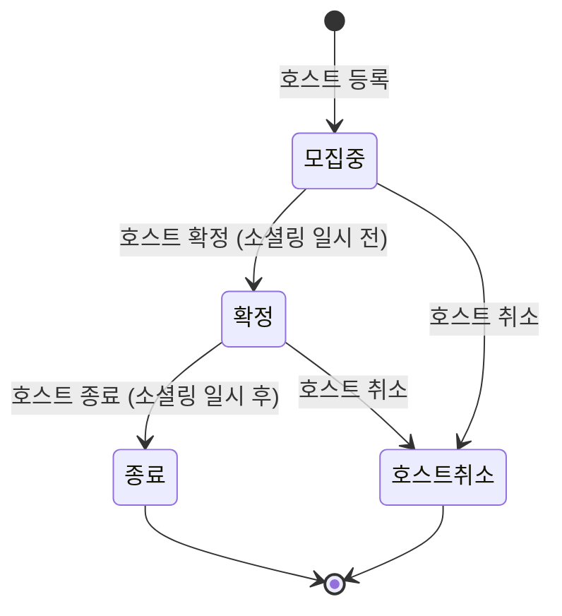
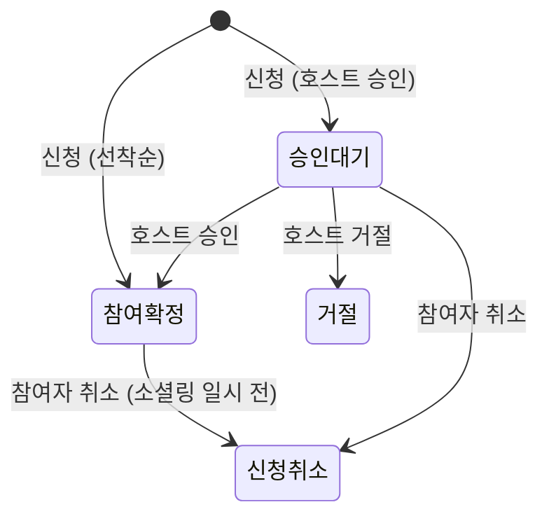
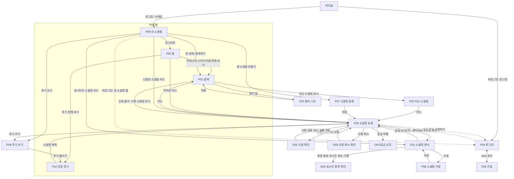

# 스펙: 무엇을 만드나

- 이 문서가 기능·화면·상태 규칙의 기준이다. 동작이 바뀌면 같은 PR에서 이 문서를 고친다. 결정의 이유는 [decisions.md](decisions.md).
- 기능 ID: `M1`~`M11` (Must), `SH1`~`SH4` (Should), `Q1`~`Q4` (품질 기준). 화면 ID: `P00`~`P11` (페이지), `O01`~`O05` (창).
- 화면의 경우(상태·분기) 목록과 ID: [screen-cases.md](screen-cases.md). 디자인 값과 컴포넌트 이름: 저장소 맨 위 [DESIGN.md](../DESIGN.md).
- 문서 우선순위: 이 문서(동작·문구) > DESIGN.md(색·글꼴·컴포넌트) > 화면 시안·와이어프레임(배치 그림). 서로 다르면 위가 맞다.

---

## 1. 제품

**문화소셜링**(가칭): 관심사가 맞는 사람들이 오프라인 공간에서 가볍게 만나는 1회성 모임("소셜링")을 찾고 신청하는 모바일 웹.

- 데모 메시지: **"신청 전에 믿고 고르는 소셜링"**. 신청 전에 장소·일시·총 참가비·진행 상태·호스트 기록을 보여 주고, 참여를 마친 사람의 인증 후기가 쌓인다.
- 대상: 참여자 서윤(29세, 직장인, 배우는 소셜링에 관심), 호스트 도현(34세, 스터디지점에서 영어 회화 소셜링을 여는 일반 회원). 둘 다 가상 인물이고 시드 데모 계정 A·B의 닉네임이다.
- 첫 카테고리는 배움·자기계발. 시드 소셜링도 배움 위주다.
- PM 교육과정 과제의 데모다. 실제 결제·실사용자는 없다.

## 2. 용어 (코드와 화면 모두 이 용어를 쓴다)

| 용어 | 정의 | 코드 이름 |
|---|---|---|
| 소셜링 | 호스트가 여는 1회성 오프라인 모임. "모임", "이벤트"라고 쓰지 않는다 | `socialing` |
| 카테고리 | 소셜링의 목적. 5개(6장) | `category` |
| 술 여부 | 술이 있는지. 모든 소셜링이 밝힌다 | `has_alcohol` |
| 소셜링 일시 | 소셜링이 시작하는 날짜와 시간 | `starts_at` |
| 신청 마감 일시 | 신청할 수 있는 마지막 시각. 소셜링 일시와 같거나 앞선다 | `apply_deadline_at` |
| 정원 | 참여 확정할 수 있는 최대 참가자 수. 스태프는 세지 않는다 | `capacity` |
| 스태프 | 호스트를 돕는 사람. 참가 인원에 세지 않고 따로 보여 준다 | `staff_count` |
| 총 참가비 | 참여자가 내는 금액의 합계. 항목별 내역은 없다 | `fee` |
| 참가비 설명 | 총 참가비가 무엇에 쓰이는 돈인지, 현장에서 따로 내는 돈이 있는지 호스트가 쓰는 짧은 글 하나. 유료면 필수. 항목별 내역이 아니다 | `fee_note` |
| 대표 사진 | 카드·상세 위의 사진 1장. 선택. 없으면 카테고리 그림 | `cover_photo_path` |
| 모집 방식 | **선착순**(신청 즉시 참여 확정) / **호스트 승인**(호스트가 승인해야 참여 확정) | `join_type`: `first_come` / `approval` |
| 승인 기준 | 호스트 승인 소셜링에서 호스트가 밝히는 기준. 호스트 승인이면 필수(MS14부터, 그 전에 기준 없이 연 소셜링은 상자 없이 보인다). 신청 전에 누구나 본다 | `approval_criteria` |
| 연령 조건 | 호스트 승인 소셜링에서 호스트가 정하는 만 나이 범위(최소·최대 중 하나 이상). 선택. 신청할 때 나이를 확인하지 않는다 | `min_age` · `max_age` |
| 자료 링크 | 소셜링 전에 미리 볼 자료 주소 하나(`https://`). 선택, 누구나 본다 | `material_url` |
| 모집중 | 등록 직후 상태 | `recruiting` |
| 확정 | 호스트가 "열린다"고 확정 버튼을 누른 상태. 소셜링 일시 전에만. 최소 인원·자동 확정은 없다 | `confirmed` |
| 종료 | 소셜링이 끝난 뒤 호스트가 종료 버튼을 누른 상태. 소셜링 일시 이후에만 | `completed` |
| 호스트 취소 | 호스트가 소셜링을 열지 않기로 한 상태. 종료 전에만 | `canceled` (소셜링) |
| 신청 | 참여 의사를 보내는 것 | `application` |
| 승인 대기 / 참여 확정 / 거절 / 신청 취소 | 신청 상태 | `pending` / `accepted` / `rejected` / `canceled` |
| 신청 마감 · 정원 마감 | 신청할 수 없는 이유를 보여 주는 꼬리표. 상태가 아니라 계산 값 | - |
| 현재 소셜링 / 지난 소셜링 | 소셜링 일시가 지금 이후 / 지금 이전 (상태와 무관) | `starts_at > now()` / `<= now()` |
| 내 소셜링 | 내가 신청했거나 호스트인 소셜링 모음 | - |
| 스터디지점 | 서비스 소유 공간(가상 3곳). 소재 구를 가진다 | 장소 유형 `branch` |
| 지역 | 장소를 시·도 > 시·군·구로 거르는 기준. 그 지역의 스터디지점과 외부 장소를 모두 거른다 | `region` (장소 유형 `branch`·`external` 모두) |
| 인증 후기 | 참여 확정자가 종료된 소셜링에 한 번 쓰는 후기. 별점 없음, 글 + 선택 사진, 즉시 공개 | `review` |
| 비공개 확인 질문 | 후기 작성 때 받는 예/아니오 질문 3개. 개별 응답은 누구에게도 보이지 않고 합계만 호스트 기록에 쓴다 | `review_check` |
| 호스트 기록 | 누구나 보는 호스트의 행동 기록 4가지. 기록이 적으면 "새 호스트" | 계산 값 |
| 기준 공개 등급 | 조건을 화면에 그대로 밝히고 조건으로만 정해지는 라벨 "믿고 가는 호스트" | 계산 값 |
| 회원 유형 | 가입은 모두 일반 회원. 누구나 호스트가 될 수 있다 | `role`: `member` / `host` / `admin` (지금은 `member`만 씀) |

쓰지 않는 말: 모임·이벤트(→ 소셜링), 진행 확정·확정 마감·인원 미달 취소, 이성 교류, 관리자(호스트 화면을 가리킬 때).

## 3. 상태 규칙

### 3.1 소셜링 상태 (호스트 버튼으로만 바뀐다)

- 모집중에서 바로 종료할 수 없다.
- 시간이 지나도 상태는 자동으로 바뀌지 않는다. 확정하지 않은 채 소셜링 일시가 지난 모집중 소셜링은 그대로 남는다. 예약 작업(cron)은 없다.
- 목록에 보이는지(현재/지난)는 상태가 아니라 소셜링 일시로 정한다.

### 3.2 신청 가능 (저장하지 않고 계산)

신청 가능 = 상태가 모집중 또는 확정 **그리고** `now() < 신청 마감 일시` **그리고** 참여 확정 인원 < 정원.
참여 확정 인원 = 그 소셜링의 `accepted` 신청 수.

### 3.3 신청 상태

- 한 사람은 한 소셜링에 유효한 신청(승인 대기·참여 확정)을 하나만 가진다. 호스트 본인은 신청할 수 없다.
- 거절·신청 취소 뒤 같은 소셜링에 다시 신청할 수 있다(새 신청 행).
- 승인 대기·참여 확정은 소셜링 일시 전까지 취소할 수 있다.
- 소셜링이 호스트 취소되면 신청 상태는 바꾸지 않고, 화면에서 "호스트 취소"로 덮어 보여 준다. 그 뒤에는 신청을 취소할 수 없다(호스트 취소 수가 줄지 않게, 6장).
- 정원을 넘는 참여 확정은 동시 신청에서도 생기지 않는다.

### 3.4 인증 후기 작성 조건

참여 확정자 **그리고** 소셜링 상태가 종료 **그리고** 그 소셜링에 아직 후기를 쓰지 않음.

## 4. 기능 (Must)

모든 기능은 5장 품질 기준을 완료 기준에 포함한다.

### M1. 둘러보기 (로그인 없음)
- 홈(P00), 탐색(P01), 지난 소셜링(P02), 상세(P03), 인증 후기(P10)는 로그인 없이 본다.
- 탐색 목록은 현재 소셜링을 소셜링 일시가 가까운 순으로 보이고, 위에 "가까운 일시 순 · 유료 노출 없음"을 표시한다.
- 지난 소셜링은 탐색 목록에서 빠지고 P02에서 본다(최근 순).
- 신청 마감 뒤 소셜링 일시 전이면 목록에 남고 "신청 마감" 꼬리표가 붙는다. 정원이 차면 "정원 마감" 꼬리표.
- 카드 항목과 배치는 8.5.
- 홈은 탐색과 별도 화면이고, 규칙으로만 채운 묶음과 바로가기를 둔다(P00). 운영자가 고르거나 유료로 올리는 자리는 없다.

### M2. 성격 구분
- 모든 소셜링은 카테고리 하나와 술 여부를 가지고, 카드·상세에 보인다.
- 파티·사교도 기본으로 보인다. 탐색 위 "파티·사교 숨기기" 토글(기본 꺼짐)을 켜면 파티·사교 카테고리가 빠진다.
- 카테고리 이름과 화면 문구에 "이성 교류" 같은 표현을 쓰지 않는다.

### M3. 탐색 필터
- 카테고리(여러 개), 날짜(전체 · 오늘 · 이번 주 · 이번 주말 중 하나), 장소, 참가비, 술 여부로 거른다. 장소는 두 갈래: **스터디지점**(전체 지점 또는 지점 하나, 스터디지점 소셜링만) / **지역**(시·도 → 시·군·구, 시·도 전체도 고를 수 있음. 그 지역의 스터디지점과 외부 장소 소셜링 모두).
- 참가비는 총 참가비 구간 하나: 전체 · 무료(0원) · 1만 원 이하(1~10,000원) · 1만~2만 원(10,001~20,000원) · 2만 원 넘음(20,001원 이상). 구간은 겹치지 않아 "1만 원 이하"에 무료는 들어가지 않는다.
- 술 여부는 전체 · 술 없음 중 하나. "술 없음"은 술 있는 소셜링을 모두 뺀다. "파티·사교 숨기기"와 따로 움직여 둘 다 켜면 둘 다 적용하고, 카테고리에서 파티·사교를 골라도 꺼지지 않는다.
- "소셜링 N개"는 거른 뒤의 개수. 결과가 없으면 "조건에 맞는 소셜링이 없어요"와 필터 초기화(필터와 토글 모두 지움).
- 필터·토글 값은 주소(`/explore?…`)에 담는다. 상세에 갔다 뒤로 와도 유지되고, 아래 탭으로 탐색에 오면 초기 상태.

### M4. 소셜링 상세
- 맨 위 대표 사진(4:3, 없으면 카테고리 그림). 제목 아래 호스트 한 줄(닉네임 · 등급 라벨).
- 소개(5줄 넘으면 접고 "더보기"), 상태, 카테고리·술 여부, 소셜링 일시, 신청 마감 일시, 장소, 총 참가비(참가비 설명이 있으면 그 아래 줄에 설명 전체, 줄바꿈 그대로. 무료여도 설명이 있으면 보인다), 모집 방식, 연령 조건(호스트 승인이고 조건이 있을 때: "20~39세" · "30세 이상" · "39세 이하"), "참가자 4/8명 · 스태프 1명"(스태프는 정원에 세지 않음, 스태프 0명이면 "참가자 4/8명"만), 자료(링크가 있을 때, 정보 카드 맨 아래 "자료 보기" + 사이트 이름, 누르면 새 창으로 열고 이 앱 정보를 넘기지 않음), 승인 기준(호스트 승인이고 입력했을 때), 호스트 영역(M5). 목록 카드·필터에는 참가비 설명·연령 조건·자료가 없다.
- 맨 아래(아래 고정 영역 바로 위) "신청 전에 확인해 주세요" 묶음: 소셜링 규칙(6장, 호스트와 참가자 모두 하면 안 되는 행동 3가지). 모든 상세에 늘 펼쳐 보이고 호스트가 바꾸거나 끌 수 없다. 그 아래 총 참가비가 있고 소셜링 일시 전이면 "취소·환불 규칙" 접는 줄(처음엔 접힘, 6장 환불 기준. 이미 지난 구간 줄은 빼고 보인다). 참가비 0원이거나 일시가 지나면 접는 줄은 없다. 맨 아래 신고 줄 "이 소셜링에서 문제를 겪었나요?" + **신고하기**(SH4b, 호스트 본인에게는 없음): 사유 하나와 설명을 받아 접수만 한다(처리·결과 알림 없음, 10장). 로그인한 사람은 신청하지 않았어도, 소셜링 상태와 관계없이 소셜링 하나에 한 번 신고할 수 있고, 접수했으면 줄이 "신고를 접수했어요"가 된다. 신고는 호스트 기록·등급에 쓰지 않는다.
- 아래 고정 영역은 보는 사람과 상태에 따라 8.4 표 하나로 정한다. 신청할 수 없으면 이유를 보여 준다.
- 호스트 연락처는 보이지 않는다.

### M5. 호스트 기록과 기준 공개 등급
- 상세의 호스트 영역: 열린 소셜링 수, 호스트 취소 수, 소개 일치 비율, 후기 수. 계산 규칙은 6장. "최근 6개월 기록 · 별점이나 점수로 합치지 않아요" 문구를 함께 보인다. 칸 글자는 시안대로 "열린 소셜링 6회" · "호스트 취소 0회" · "소개 일치 92%"(아래 "응답 12건", 비율은 반올림한 정수 %) · "후기 12개".
- 기록이 적으면 숫자 대신 "새 호스트 · 기록이 쌓이면 숫자로 보여 줘요"(위 기준 문구는 그대로).
- 등급 조건을 채우면 "믿고 가는 호스트" 라벨을 제목 아래 호스트 한 줄과 호스트 영역의 닉네임 아래에 보인다. 라벨을 누르면 O03에 조건 3개와 이 호스트의 실제 값을 보인다. 등급은 호스트 기록을 계산하는 DB 함수가 정하고(소개 일치는 반올림 전 값), 호스트 기록을 불러오지 못하면 라벨도 보이지 않는다.
- 호스트 취소는 횟수만 보인다. 어느 소셜링인지, 기록에서 빠지는 날짜는 보이지 않는다.
- 별점, 온도, 점수 하나로 합친 값은 만들지 않는다.

### M6. 가입·로그인
- 이메일 + 비밀번호. 가입 필수 입력은 이메일, 비밀번호, 닉네임뿐(프로필 사진 없음).
- 이메일 인증 없음. 가입하면 바로 로그인된다.
- 신청·신청 취소·후기·신고·호스트 버튼, 내 소셜링, 소셜링 등록에서만 로그인을 요구하고, 로그인 뒤 보던 화면으로 돌아온다(8.7).
- 시연은 미리 만든 데모 계정으로 한다.

### M7. 신청과 신청 취소
- 선착순은 누르면 바로 참여 확정, 호스트 승인은 승인 대기.
- 신청 전에 O02 "신청할까요?"에서 소셜링 요약(제목 · 소셜링 일시 / 장소 · 총 참가비 / 설명이 있으면 "참가비 설명: …"), 연령 조건(있을 때, 승인 기준 위 한 줄 "연령 조건 20~39세". 신청할 때 나이를 확인하지 않는다), 승인 기준(있을 때), 결과 안내(선착순 "신청하면 바로 참여가 확정돼요" / 호스트 승인 "호스트가 승인하면 참여가 확정돼요"), 총 참가비가 있으면 "취소·환불 규칙"(6장 환불 기준, 상세 접는 줄과 같은 글, 접지 않음)을 보인다. 참가비 0원이면 환불 규칙도 결제 안내도 없다. 버튼은 돌아가기 / 신청하기.
- 신청 취소는 상세에서만, O05 확인 창을 거친다. 소셜링 일시 전까지. 총 참가비가 있으면 창을 여는 순간 기준으로 "지금 취소하면 … 기준이에요" 한 줄을 보인다(6장 환불 기준).
- 실제 결제·환불은 없다(10장). 환불 규칙은 안내만 한다.
- 신청 순간 신청할 수 없게 된 경우의 이유와 결과는 8.4.

### M8. 호스트 버튼
일반 화면 안에서 그 소셜링의 호스트에게만 보인다. 버튼은 소셜링 관리 화면(P11)에 모으고, 상세에는 호스트에게만 "관리하기"를 둔다. 어드민 화면이 아니다.
- **등록**(P07): 제목, 소개, 자료 링크(선택), 카테고리, 술 여부, 장소, 소셜링 일시, 신청 마감 일시, 총 참가비, 참가비 설명(유료면 필수), 정원, 스태프 인원, 모집 방식, 승인 기준(호스트 승인일 때만 보이고 필수), 연령 조건(선택, 호스트 승인일 때만 보임: 제한 없음 · 나이 정하기), 대표 사진(선택, 1장). 선착순으로 바꾸면 승인 기준과 연령 조건은 저장되지 않는다. 사진 업로드가 실패해도 나머지는 저장되고 사진은 수정에서 다시 올린다. 장소는 두 갈래: **스터디지점**(지점 하나) / **지역**(시·도 → 시·군·구를 고르고 장소 이름을 쓴다. 저장하면 그 지역의 외부 장소가 된다). 입력 범위는 6장.
- **수정**(P08): 등록과 같은 양식. 참여 확정자가 있으면 소셜링 일시·장소·총 참가비·참가비 설명을 바꿀 수 없고(이유 표시. 비어 있던 참가비 설명은 채울 수 있다), 정원은 참여 확정 인원 아래로 줄일 수 없다. MS14 전에 설명 없이 연 유료 소셜링과 기준 없이 연 호스트 승인 소셜링은 수정할 때 채워야 저장된다. 승인 대기 신청이 있으면 모집 방식을 바꿀 수 없다("승인 대기 신청이 있어 바꿀 수 없어요", 승인·거절을 먼저 하면 바꿀 수 있음). 소셜링 일시가 지금 이후인지는 일시를 바꿀 때만 본다. 종료·호스트 취소된 소셜링은 수정할 수 없다.
- **승인·거절**: 승인 대기 신청에, 소셜링 일시 전까지. 정원이 차면 승인할 수 없다.
- **확정**: 모집중일 때, 소셜링 일시 전까지.
- **호스트 취소**: 종료 전까지.
- **종료**: 확정 상태이고 소셜링 일시가 지났을 때.
- 확정·호스트 취소·종료·거절은 O04 확인 창을 거친다. 불가 조건과 이유 문구는 8.8.

### M9. 인증 후기
- 작성 조건은 3.4. 조건이 안 맞으면 P03으로 보내고 이유를 보인다(8.7).
- 글(필수, 10~500자, 글자 수 표시. 앞뒤 공백·줄바꿈은 세지 않는다) + 사진(선택, 1장). 별점 없음. 작성 즉시 공개.
- 비공개 확인 질문 3개(예/아니오, 필수, 질문은 6장). "개별 응답은 호스트를 포함해 누구에게도 보이지 않아요. 합계만 호스트 기록에 쓰여요." 안내.
- 사진 업로드가 실패해도 글이 남고, "다시 고르기" 또는 "사진 없이 올리기"를 할 수 있다.

### M10. 후기 피드 (화면 이름 "인증 후기", P10)
- 공개된 인증 후기를 최신순으로: 작성자 닉네임, 작성일("10/14"), 참여 인증 표시, 소셜링 제목(누르면 P03), 사진, 글. 최신 50개까지 보이고 더 불러오기는 없다.
- 제목 아래 기준 문구 "참여를 마친 사람만 쓸 수 있어요 · 최신순".
- 맞춤 정렬, 좋아요, 댓글은 없다.

### M11. 내 소셜링 (P06)
- **신청한 소셜링** 탭: 카드(누르면 P03) + 신청 상태(승인 대기, 참여 확정, 거절, 호스트 취소). 다가오는 소셜링(가까운 일시 순) 먼저, 지난 소셜링(최근 순) 뒤. 후기를 쓸 수 있으면 "후기 쓰기" 버튼. 호스트 취소된 소셜링은 상태 배지와 신청 칩이 같은 글자라 "호스트 취소" 하나만 보인다. 내가 신청 취소한 소셜링은 목록에 없다(다시 신청하면 다시 보인다). 거절·호스트 취소는 알림이 없어 여기서 알아야 하므로 남긴다.
- **호스트인 소셜링** 탭: 카드(누르면 P11) + 소셜링 상태 + 승인 대기 건수(0이면 보이지 않음), "새 소셜링 만들기" 버튼. 순서는 신청한 소셜링 탭과 같다(다가오는 → 지난).
- 닉네임과 로그아웃.

## 5. 품질 기준 (모든 화면)

| # | 조건 | 완료 기준 |
|---|---|---|
| Q1 | 핵심 시나리오 자동 테스트 | 7장 시나리오 1~9단계를 Playwright E2E(`ms9-scenario`)가 통과해야 dev와 main에 합친다. 기능마다 해당 단계 테스트를 함께 추가한다 |
| Q2 | 로딩·오류 화면 | 데이터를 불러오는 모든 화면에 로딩 상태와 오류 화면이 있고, 다시 시도·돌아가기가 된다 (8.6) |
| Q3 | 부가 기능 격리 | 피드·호스트 기록 조회가 실패해도 상세와 신청은 동작한다 |
| Q4 | 사진 실패 안전 | 사진 업로드를 실패시켜도 글과 입력이 남고 사진 없이 제출된다. 기기 권한을 따로 요구하지 않는다 |

## 6. 재량 값

| 항목 | 값 |
|---|---|
| 카테고리 (순서대로) | 배움·자기계발, 취미, 운동·활동, 문화·예술, 파티·사교. 파티·사교만 숨기기 토글 대상 |
| 술 여부 | 있음 / 없음 (화면: "술 있음" / "술 없음") |
| 집계 기간 | 최근 6개월 (소셜링 일시가 6개월 전 이후인 소셜링. 앞으로 열릴 소셜링도 포함해서, 호스트 취소는 바로 센다) |
| 열린 소셜링 | 종료 상태이고 참여 확정자가 1명 이상인 소셜링 |
| 호스트 취소 수 | 참여 확정 또는 승인 대기 신청이 있던 상태에서 호스트 취소된 소셜링 수 |
| 비공개 확인 질문 | ① 참가자 구성이 소개와 같았나요? ② 앱에 적힌 금액 외에 돈을 요구받았나요? ③ 진행 내용이 소개와 같았나요? |
| 환불 기준 (안내만) | 총 참가비가 있을 때만 보인다. 참여 확정 뒤 신청 취소: 소셜링 일시 72시간 전까지(그 시각 포함) 전액, 24시간 전까지 50%, 그 뒤 없음. 승인 전 신청 취소·호스트 거절·호스트 취소는 언제든 전액(선착순은 "호스트 취소"만). 화면에는 계산한 실제 시각("10/19(월) 오후 7:30까지: 전액 환불")을 쓰고 이미 지난 구간 줄은 뺀다("… 뒤: 환불 없음"은 늘 남음). 그 아래 "참여 확정자가 생기면 일시·장소·참가비는 바뀌지 않아요", "결제 기능이 없는 데모예요. 실제 결제와 환불은 일어나지 않아요". O05 한 줄: 승인 대기 "승인 전 취소라 전액 환불 기준이에요" / 참여 확정 "지금 취소하면 전액 환불 기준이에요" · "지금 취소하면 50% 환불 기준이에요" · "지금 취소하면 환불되지 않는 기준이에요". 계산은 `lib/refund-policy.ts` 한 곳 |
| 소셜링 규칙 (상세) | 제목 "소셜링 규칙", "호스트와 참가자 모두 아래 행동을 할 수 없어요" · 종교 활동이나 영업 권유하기 · 앱에 적힌 금액 외에 돈을 요구하기 · 운영 스태프를 참가자인 것처럼 소개하기. 2·3번은 비공개 확인 질문 ②·①과 같은 말 |
| 소개 일치 비율 | ①예 · ②아니오 · ③예 를 모두 만족한 응답의 비율. 응답 5건 이상일 때만 숫자, 아니면 "응답 5건 이상부터 보여요" |
| 새 호스트 | 열린 소셜링 3회 미만 |
| 기준 공개 등급 | "믿고 가는 호스트": 열린 소셜링 5회 이상 + 호스트 취소 0회 + 소개 일치 비율 90% 이상 |
| 후기 글 | 10자 이상 500자 이하 |
| 신고 설명 | 300자까지(앞뒤 공백 제외). 사유가 "그 밖의 문제"면 필수 |
| 후기 사진 · 대표 사진 | 각 1장, 선택. 업로드 전에 브라우저에서 1MB 이하로 줄인다 |
| 사진 비율 | 카드 정사각, 상세·히어로 4:3, 후기 4:3으로 잘라 보임 |
| 정원 | 2~20명 |
| 스태프 인원 | 0~20명 |
| 총 참가비 | 0~1,000,000원 |
| 참가비 설명 | 100자까지(최소 없음, 앞뒤 공백 제외). 총 참가비가 0보다 크면 필수, 0원이면 선택 |
| 소셜링 제목 | 1~40자 (앞뒤 공백 제외) |
| 소셜링 소개 | 20~1000자 (앞뒤 공백·줄바꿈 제외) |
| 승인 기준 | 200자까지, 호스트 승인이면 필수 |
| 연령 조건 | 호스트 승인일 때만, 선택. 만 나이 최소·최대 중 하나 이상, 1~99세, 최소 ≤ 최대 |
| 자료 링크 | 선택. `https://`로 시작하는 주소 하나, 500자까지 |
| 외부 장소 이름 | 1~40자 |
| 닉네임 | 2~12자, 다른 사람과 중복 불가 |
| 비밀번호 | 6자 이상 (Supabase Auth 설정의 최소 길이 6, 2026-10-13 확인) |
| 날짜·시간 표시 | 한국 시간(Asia/Seoul). 예: `10/14(화) 오후 7:30` |
| 날짜 필터 | 한국 시간 기준. 오늘 = 오늘 0시~24시, 이번 주 = 오늘부터 이번 주 일요일 끝까지, 이번 주말 = 이번 주 토·일 (오늘이 일요일이면 오늘) |

## 7. 시연 시나리오와 시드 조건

데모 계정: 참여자 A(서윤), 호스트 B(도현). 두 브라우저(일반·시크릿)로 오간다.

| 단계 | 누가 | 행동 | 보여 주는 것 | 화면 | 기능 |
|---|---|---|---|---|---|
| 1 | 비로그인 | 목록을 연다 | 카테고리·술 여부, "가까운 일시 순" 기준 | P00 → 전체 보기 → P01 | M1, M2 |
| 2 | 비로그인 | 파티·사교 숨기기를 켜고 스터디지점 필터를 건다 | 원하는 성격만 남음 | P01 토글 → O01 → P01 | M2, M3 |
| 3 | 비로그인 | 상세를 연다 | 상태, 참여 확정 인원/정원, 스태프 분리, 총 참가비, 승인 기준, 호스트 기록과 등급 | P03 (O03) → 뒤로 → P01 필터 유지 | M4, M5 |
| 4 | A | 신청 → 로그인 → 상세로 돌아와 신청 | 로그인 복귀, 승인 대기 | P03 → P04 → P03 → O02 → P03 | M6, M7 |
| 5 | B | 호스트인 소셜링에서 A를 승인하고 확정 | 호스트 전용 버튼 | P06 → P11 → 승인 → 확정(O04) | M8, M11 |
| 6 | A | 참여 확정과 확정 상태를 본다 | 상태 투명성 | P06 신청한 소셜링 | M4, M11 |
| 7 | B | 일시가 지난 확정 소셜링 X를 종료 | 종료 뒤 후기 열림 | P06 → X의 P11 → 종료(O04) | M8 |
| 8 | A | X에 사진과 비공개 질문 답을 넣어 인증 후기 | 참여 마친 사람만 작성, 별점 없음 | P06 X "후기 쓰기" → P09 | M9 |
| 9 | A | 방금 쓴 후기와 B의 후기 수 증가를 본다 | 인증 후기, 호스트 기록 갱신 | P10 → 소셜링 제목 → P03 | M10, M5 |
| 10 | B (선택) | 새 소셜링을 등록 | 등록 화면 | P06 → P07 → P03 → P01 | M8 |

**시드가 반드시 만드는 것**
- 소셜링 X: 호스트 B, 확정, A가 참여 확정, 소셜링 일시는 시드 시점보다 과거. 4~6단계 소셜링은 일시가 미래라 종료할 수 없으므로 7~9단계는 X로 한다.
- 소셜링 Y(대체용): 호스트 B, 이미 종료, A 참여 확정, 후기 없음.
- 4~6단계용: 호스트 B, 호스트 승인 방식, 모집중, 일시 미래, 승인 기준 있음.
- B는 "새 호스트"가 아니고 등급 조건을 채운다(열린 소셜링 5회 이상 등). 다른 호스트 중 하나는 "새 호스트", 하나는 기록 숫자만 있고 등급 없음.
- 상태별 소셜링(모집중, 확정, 신청 마감, 정원 마감, 종료, 호스트 취소, 확정 안 된 채 일시 지남), 배움 위주 + 다른 카테고리 일부, 파티·사교 1개 이상, 술 있음 1개 이상(그중 술 있는 배움 소셜링 1개 이상: 파티·사교를 숨겨도 남는 술 자리라 "술 없음" 필터와 결과가 갈림), 사진 없는 소셜링 몇 개, 대표 사진이 있는 소셜링과 사진이 있는 인증 후기 몇 개(AI로 만든 이미지, 출처 `scripts/seed-assets/SOURCES.md`).
- 장소: 가상 스터디지점 3곳(강남점 서울 강남구, 홍대점 서울 마포구, 성수점 서울 성동구) + 외부 장소(실제 구 이름 + 가상 장소명). 서울 몇 개 구에 모아 필터 결과가 비지 않게.
- 지역: 전국 시·도 > 시·군·구.
- 2묶음(MS14): 유료 소셜링은 모두 참가비 설명(그중 몇 개는 현장에서 따로 내는 돈을 적음), 호스트 승인 소셜링은 모두 승인 기준, 호스트 승인 소셜링 하나("필름 카메라로 골목 산책", 하린)에 연령 조건 20~39세와 A의 거절된 신청(사유 "승인 기준과 맞지 않아요" + 덧붙인 말), 지나지 않은 배움 소셜링 몇 개에 자료 링크(위키백과). 신고는 없다. 시연 1~10단계 소셜링의 상태·인원·일시는 바꾸지 않는다.
- 기존 인증 후기와 비공개 응답(소개 일치 비율 계산용).
- 모든 날짜는 시드 실행 시점 기준 상대값. 발표 직전에 다시 실행한다.

## 8. 화면

### 8.1 원칙
- 휴대폰 세로 390px 기준. PC에서도 390px 폭을 가운데에 보인다.
- 아래 탭 4개: **홈** · **탐색** · **후기**(P10 인증 후기) · **내 소셜링**. 탭 화면은 머리글 + 아래 탭, 나머지 화면은 뒤로 버튼이 있는 머리글만. 예외로 지난 소셜링(P02)은 뒤로 버튼이 있는 머리글 + 아래 탭(탐색이 켜짐)이다.
- 머리글: "문화소셜링"(누르면 홈). 오른쪽은 비로그인이면 **로그인**(→ P04 `?next=지금 주소`), 로그인이면 닉네임 첫 글자가 든 원(→ P06, DESIGN.md `avatar-initial/strong`). 닉네임 전체와 로그아웃은 P06 맨 위에 있다.
- 화면 이름은 화면 위 제목과 같다.
- 알림(푸시·메일·문자)은 없다. 신청 상태 변화는 P06과 P03에서 확인한다.
- 모든 묶음은 규칙으로만 채우고 기준을 함께 적는다.

### 8.2 화면 목록

| ID | 화면 | 주소 | 로그인 | 들어가는 것 |
|---|---|---|---|---|
| P00 | 홈 | `/` | 없음 | 히어로(지금 신청할 수 있는 소셜링 중 일시가 가장 가까운 1개, 대표 사진 크게, 기준 문구 "기준: 지금 신청할 수 있는 소셜링 중 가장 가까운 일시 · 유료로 위에 올리는 소셜링은 없어요"), 카테고리 바로가기 5개(→ P01 그 카테고리), 스터디지점 바로가기 3개(→ P01 그 지점), "곧 열리는 소셜링"(가까운 일시 순 3개, 히어로 소셜링과 호스트 취소는 뺌, 전체 보기 → P01), "최근 인증 후기"(최신 2개, 전체 보기 → P10) |
| P01 | 탐색 | `/explore` | 없음 | "가까운 일시 순 · 유료 노출 없음", 필터 칩 한 줄(전체 필터 + 날짜 · 장소 · 카테고리 · 참가비 · 술 여부, 적용하면 값 표시: "이번 주", "강남점"·"전체 지점"·"마포구"·"서울 전체", "배움·자기계발 외 1", "1만 원 이하", "술 없음". 칩이 넘치면 가로로 넘겨 봄), 그 아래 파티·사교 숨기기 토글, "소셜링 N개"(지금 목록의 개수), 카드 목록, "지난 소셜링 보기" 링크 |
| O01 | 필터 시트 | P01 위 | 없음 | 제목 "필터" + 닫기. 칩에서 열면 그 항목 위치로. 카테고리(여러 개), 날짜(전체 · 오늘 · 이번 주 · 이번 주말), 장소(스터디지점: 전체 지점 · 지점 / 지역: 전국 · 시·도 → 그 시·도 전체 · 구), 참가비(전체 · 무료 · 1만 원 이하 · 1만~2만 원 · 2만 원 넘음 중 하나, 칩을 줄바꿈으로), 술 여부(전체 · 술 없음), 초기화(시트에서 고른 값만, 토글은 그대로), 적용("소셜링 N개 보기", 고르는 대로 개수가 바뀜). 닫으면 적용하지 않음 |
| P02 | 지난 소셜링 | `/past` | 없음 | 기준 문구 "소셜링 일시가 지난 소셜링 · 최근 순", 소셜링 일시가 지난 카드(최근 순), 상태 그대로(종료·호스트 취소·모집중) |
| P03 | 소셜링 상세 | `/socialings/[id]` | 없음 (버튼은 로그인) | M4 항목 전부, 아래 고정 영역(8.4) |
| O02 | 신청 확인 | P03 위 | 필요 | 승인 기준(있을 때), 결과 안내, 취소·환불 규칙(총 참가비가 있을 때, 6장), 신청 버튼 |
| O03 | 등급 조건 | P03 위 | 없음 | 제목 "등급 조건"(앞에 라벨), "최근 6개월 기록으로 아래 3가지를 모두 채운 호스트예요", 조건 3개(열린 소셜링 5회 이상 · 호스트 취소 0회 · 소개 일치 90% 이상)와 이 호스트의 실제 값("6회" · "0회" · "92% (응답 12건)"), "별점이나 점수가 아니라 공개된 기록으로만 정해요", 확인 |
| O04 | 호스트 동작 확인 | P11 위 | 호스트 | 확정·호스트 취소·종료·거절 전 확인 문구와 되돌릴 수 없다는 안내 |
| O05 | 신청 취소 확인 | P03 위 | 필요 | "신청을 취소할까요?", 선착순이면 "취소하면 다른 사람이 자리를 채울 수 있어요.", 총 참가비가 있으면 그 아래 환불 기준 한 줄(6장), 돌아가기 / 신청 취소 |
| P04 | 로그인 | `/login?next=…` | - | 안내 "로그인하면 보던 화면으로 돌아가요", 이메일, 비밀번호(보기 버튼), 가입 링크(`next` 그대로) |
| P05 | 가입 | `/signup?next=…` | - | 위 안내 "새로운 여정 · 함께할 문화 메이트를 찾아요", 이메일, 비밀번호(보기 버튼, 도움말 "6자 이상"), 닉네임(도움말 "2~12자 · 후기와 호스트 이름으로 보여요"), "가입하고 시작하기". 가입 즉시 로그인 |
| P06 | 내 소셜링 | `/me` (`?tab=host`) | 필요 | M11 |
| P07 | 소셜링 등록 | `/socialings/new` | 필요 | M8 등록 항목 |
| P08 | 소셜링 수정 | `/socialings/[id]/edit` | 호스트 | P07과 같은 양식 + 잠금 |
| P09 | 후기 쓰기 | `/socialings/[id]/review` | 작성 조건 | 소셜링 요약("종료" + "참여 확정", 제목, "일시 · 장소 · 호스트 닉네임"), 글(안내 "어떤 시간이었는지 다음 참여자에게 알려 주세요"), 사진, 비공개 질문 3개, 아래 고정 "후기 올리기" + 이유 한 줄 |
| P10 | 인증 후기 | `/reviews` | 없음 | M10 |
| P11 | 소셜링 관리 | `/socialings/[id]/manage` | 호스트 | 8.8 |

### 8.3 상태 표시
- **상태 배지**는 항상 하나: 모집중 · 확정 · 종료 · 호스트 취소.
- 신청할 수 없는 이유가 있으면 배지 옆에 **꼬리표** 하나: "신청 마감"(신청 마감 일시 지남) 또는 "정원 마감"(참여 확정 인원 = 정원). 둘 다면 "신청 마감".
- 가능한 조합 8가지: 모집중 / 모집중+신청 마감 / 모집중+정원 마감 / 확정 / 확정+신청 마감 / 확정+정원 마감 / 종료 / 호스트 취소.
- 한 사람의 신청 상태는 칩으로 보인다(DESIGN.md `application-chip`). 배지와 칩은 둘 다 알약 모양이라 글자로 구분하고, 같이 놓이면 배지가 앞이다(예: "종료" "참여 확정").

### 8.4 상세 아래 고정 영역 (P03)

보는 사람과 상태에 따라 안내 한 줄과 버튼 하나. **표의 위에서부터 먼저 맞는 줄 하나만** 쓴다. 신청 가능 여부와 이유는 DB가 정한 결과를 그대로 쓴다. 로그인 뒤 돌아왔을 때도 이 표로 다시 정한다. 컴포넌트 이름은 DESIGN.md `apply-bar/*`.

| 줄 | 보는 사람 | 조건 | 안내 | 버튼 | DESIGN.md |
|---|---|---|---|---|---|
| 1 | 호스트 본인 | 항상 | "내가 연 소셜링이에요" | **관리하기** → P11. 승인 대기가 있으면 "관리하기 · 승인 대기" + 건수(Point 색) | `host-manage`, `host-manage-pending` |
| 2 | 누구나 | 호스트 취소 | "호스트가 취소한 소셜링이에요" | 다른 소셜링 보기 → P01 | `host-cancelled` |
| 3 | 참여 확정자 | 종료, 후기 없음 | "소셜링이 끝났어요" | **후기 쓰기** → P09 | `review-write` |
| 4 | 참여 확정자 | 종료, 후기 씀 | "후기 작성 완료" | 없음 | `review-done` |
| 5 | 참여 확정자 | 확정, 소셜링 일시 지남 | "참여 확정 · 소셜링 일시가 지났어요" + "호스트가 종료하면 후기를 쓸 수 있어요" | 없음 | `wait-end` |
| 6 | 참여 확정자 | 모집중 그대로, 소셜링 일시 지남 | "참여 확정 · 소셜링 일시가 지났어요" + "호스트가 확정하지 않은 소셜링이라 후기를 쓸 수 없어요" | 없음 | `not-confirmed` |
| 7 | 신청자 | 승인 대기 또는 참여 확정, 소셜링 일시 전 | 승인 대기: "호스트가 승인하면 참여 확정돼요" / 참여 확정: "10/14(화) 오후 7:30에 만나요" | **신청 취소** → O05 | `pending-cancel`, `accepted-cancel` |
| 8 | 신청자 | 승인 대기, 소셜링 일시 지남 | "소셜링 일시가 지났어요" + "호스트가 응답하지 않았어요" (저장된 상태는 그대로) | 없음 | `pending-expired` |
| 9 | 신청자 | 거절 또는 신청 취소, 지금 신청 가능 | 칩(거절/신청 취소) + "자리가 남아 있어 다시 신청할 수 있어요" | **다시 신청** → O02 | `reapply` |
| 10 | 신청자 | 거절 또는 신청 취소, 신청 불가 | 칩 + 신청할 수 없는 이유 | 다른 소셜링 보기 → P01 | `closed-after-application` |
| 11 | 비로그인 | 신청 가능 | 모집 방식 안내 | **신청하기** → P04 → P03 복귀 (복귀 뒤 한 번 더 누른다) | `apply` |
| 12 | 로그인, 신청 없음 | 신청 가능 | 모집 방식 안내 | **신청하기** → O02 | `apply` |
| 13 | 누구나 | 신청 마감 / 정원 마감 / 소셜링 일시 지남 | 비활성 버튼("신청 마감" / "정원 마감" / "지난 소셜링") + 이유 | 다른 소셜링 보기 → P01 | `closed` |

- 모집 방식 안내: 호스트 승인 "신청하면 호스트가 승인한 뒤 참여가 확정돼요", 선착순 "신청하면 바로 참여가 확정돼요".
- 13줄 이유: "참여 확정 인원이 정원에 찼어요" / "신청 마감 일시가 지났어요" / "소셜링 일시가 지났어요".
- 10줄 이유: "정원이 차서 다시 신청할 수 없어요" / "신청 마감 일시가 지나 다시 신청할 수 없어요" / "소셜링 일시가 지나 다시 신청할 수 없어요".
- **O02 성공**: 창이 닫히고 P03에 머문다. 아래 영역이 7줄로 바뀌고 "신청했어요 · 내 소셜링에서 보기"(→ P06)가 잠깐 뜬다.
- **O02 실패**: 누른 순간 신청할 수 없게 되었으면 결과 창 "신청하지 못했어요"에 이유를 보이고, 확인하면 P03을 새로 고친다: "방금 정원이 찼어요" · "신청 마감 일시가 지났어요" · "호스트가 취소한 소셜링이에요" · "이미 신청한 소셜링이에요" (호스트 본인은 1줄이라 신청 버튼이 없지만 함수가 막으면 "내가 연 소셜링에는 신청할 수 없어요"). 네트워크·서버 오류만 창을 연 채 "신청하지 못했어요. 연결을 확인하고 다시 시도해 주세요" + **다시 시도**.
- **O05 성공**: P03이 9줄 또는 10줄로 바뀌고 "신청을 취소했어요". 그 사이 취소할 수 없게 되었으면 결과 창 "신청을 취소하지 못했어요"에 이유를 보이고, 확인하면 P03을 새로 고친다: "소셜링 일시가 지나 취소할 수 없어요" · "호스트가 취소한 소셜링이에요" · "이미 처리된 신청이에요"(그 사이 호스트가 거절함). 네트워크·서버 오류만 창을 연 채 "신청을 취소하지 못했어요. 연결을 확인하고 다시 시도해 주세요" + **다시 시도**.

### 8.5 소셜링 카드 (홈·탐색·지난 소셜링·내 소셜링 공통)
- 왼쪽: 대표 사진 정사각. 없으면 카테고리 그림(연한 배경 + 카테고리 선 아이콘).
- 오른쪽 위에서 아래로: ① 상태 배지 + 꼬리표 ② 제목 1줄(넘치면 말줄임) ③ 카테고리 · 술 여부 ④ 소셜링 일시 · 장소(지점명 또는 구) ⑤ 호스트 닉네임 · 참여 확정 인원/정원(예: "4/8명". 줄이 넘치지 않게 "참가자"는 화면에 쓰지 않고 화면 읽기 프로그램에만 읽힘) · 총 참가비(0원이면 "무료").
- 연한 배경 위 흰 카드. 찜, 홍보 꼬리표는 없다.

### 8.6 화면 상태: 로딩 · 오류 · 빈 결과 · 성공 뒤

**공통**

| 종류 | 처리 |
|---|---|
| 로딩 | 카드·글 모양의 회색 틀(스켈레톤). 버튼은 처리 중 "처리 중…"으로 바뀌고 잠긴다(두 번 누름 방지, DB도 막음) |
| 입력 오류 | 칸 바로 아래 이유, 입력값 유지, 제출하면 첫 오류 칸으로 이동 |
| 네트워크·서버 오류 | 화면 전체: "불러오지 못했어요" + **다시 시도** · **홈으로**. 버튼 동작 실패: 안내 문구 + 같은 버튼 다시 누르기, 입력값 유지 |
| 묶음 하나 실패 | 그 묶음 자리에만 "불러오지 못했어요 · 다시 시도". 나머지 화면과 신청 버튼은 동작 (Q3) |
| 권한 오류 | 로그인이 끊김 → P04 `?next=지금 주소` → 돌아옴. 호스트가 아님 → P03 + "호스트만 볼 수 있어요" |
| 성공 | 화면 아래(아래 탭이나 아래 고정 영역 바로 위) 잠깐 뜨는 짧은 안내 + 아래 표의 다음 화면 |

**화면별**

| 화면 | 빈 상태 → 다음 행동 | 화면별 오류 | 성공 뒤 |
|---|---|---|---|
| P00 홈 | 히어로 대상 없음 → 히어로 숨김. 곧 열리는 소셜링 0개 → "지금 신청할 수 있는 소셜링이 없어요" + 지난 소셜링 보기. 후기 0개 → 묶음 숨김 | 묶음별 다시 시도 | - |
| P01 탐색 | 필터 결과 0 → "조건에 맞는 소셜링이 없어요" + 필터 초기화. 필터 없이 0 → "지금 열린 소셜링이 없어요" + 지난 소셜링 보기 | 목록 자리 다시 시도 | - |
| P02 지난 소셜링 | "지난 소셜링이 아직 없어요" + 탐색으로 | 목록 자리 다시 시도 | - |
| P03 상세 | 없는 소셜링 → "찾을 수 없는 소셜링이에요" + 탐색으로 · 홈으로 | 호스트 기록 실패 → 그 칸만 "기록을 불러오지 못했어요" + 다시 시도 (등급 라벨도 안 보임). 신고 시트: 사유 없이 → "신고 사유를 골라 주세요", 그 밖의 문제 + 설명 없음 → "어떤 문제였는지 적어 주세요", 설명 300자 넘음 → "설명은 300자까지 쓸 수 있어요", 네트워크·서버 오류 → 시트를 연 채 "신고하지 못했어요. 연결을 확인하고 다시 시도해 주세요" + 다시 시도. 신고 여부를 못 읽으면 신고하기를 그대로 둔다 | O02·O05 결과는 8.4. 신고 → 시트가 닫히고 "신고를 접수했어요", 줄도 "신고를 접수했어요"(그사이 이미 신고했어도 같음) |
| P04 로그인 | - | "이메일 형식이 맞지 않아요", "이메일 또는 비밀번호가 맞지 않아요" (어느 쪽인지 밝히지 않음). 서버 실패 "로그인하지 못했어요. 다시 시도해 주세요" | `next` 주소, 없으면 P00 |
| P05 가입 | - | "이메일 형식이 맞지 않아요", "이미 가입된 이메일이에요 · 로그인하기", "비밀번호는 6자 이상이에요", "닉네임은 2~12자예요", "이미 쓰는 닉네임이에요". 서버 실패 "가입하지 못했어요. 다시 시도해 주세요" | 바로 로그인 → `next` 또는 P00 + "환영해요, ○○님" |
| P06 내 소셜링 | 신청 0 → "아직 신청한 소셜링이 없어요" + 탐색하기. 호스트 0 → "아직 연 소셜링이 없어요" + 새 소셜링 만들기 | 탭별 다시 시도 | 로그아웃 → P00 |
| P07 등록 · P08 수정 | - | "소셜링 열기"는 막지 않고, 누르면 칸마다 이유(범위는 6장): "제목을 입력해 주세요" / "제목은 40자까지 쓸 수 있어요", "카테고리를 골라 주세요", "소개를 20자 이상 써 주세요" / "소개는 1000자까지 쓸 수 있어요", "https://로 시작하는 주소를 넣어 주세요"(자료 링크), "스터디지점을 골라 주세요" 또는 "시·도를 골라 주세요" · "시·군·구를 골라 주세요" · "장소 이름을 입력해 주세요" / "장소 이름은 40자까지 쓸 수 있어요", "소셜링 일시를 골라 주세요" / "소셜링 일시는 지금 이후여야 해요", "신청 마감 일시를 골라 주세요" / "신청 마감 일시는 소셜링 일시와 같거나 앞이어야 해요", "총 참가비를 입력해 주세요 (무료면 0)" / "총 참가비는 0~1,000,000원이에요", "참가비 설명을 입력해 주세요"(유료인데 비었을 때) / "참가비 설명은 100자까지 쓸 수 있어요", "정원은 2~20명이에요", "스태프 인원은 0~20명이에요", "승인 기준을 입력해 주세요" / "승인 기준은 200자까지 쓸 수 있어요", "최소 나이나 최대 나이를 하나 이상 입력해 주세요" / "나이는 1~99세예요" / "최소 나이가 최대 나이보다 클 수 없어요"(나이 정하기). 사진 올리는 중 → "사진을 올리는 중이에요" + 버튼 막힘. 저장 실패 → 입력 유지 + "소셜링을 열지 못했어요. 연결을 확인하고 다시 시도해 주세요"(P08 "저장하지 못했어요. …") + 다시 시도. P08: 잠긴 칸은 지금 값 + 자물쇠와 이유("참여 확정자가 있어 바꿀 수 없어요", 참가비 설명은 이미 썼을 때만, 모집 방식은 "승인 대기 신청이 있어 바꿀 수 없어요"), 정원 도움말 "2~20명 · 참여 확정 N명보다 적게 할 수 없어요", 오류 "참여 확정 인원(N명)보다 적게 할 수 없어요". 그사이 참여 확정·승인 대기가 생겨 거부되면 결과 창 "저장하지 못했어요" → 확인 → 잠긴 칸이 지금 값으로. 새 사진이 실패한 채 저장하면 저장된 사진은 그대로, "사진 없이 저장"을 누르면 사진을 지운다 | P07 → P03 + "소셜링을 열었어요". 사진만 실패 → P03 + "사진은 올리지 못했어요. 관리하기 → 수정에서 다시 올려 주세요". P08 → P11 + "저장했어요" |
| P09 후기 쓰기 | - | 글 10자 미만·500자 초과, 질문 미응답 → "후기 올리기" 꺼짐 + 이유 하나: "후기를 10자 이상 써 주세요" → "후기는 500자까지 쓸 수 있어요" → "세 질문에 모두 답하면 올릴 수 있어요" → 사진을 올리는 중이면 "사진을 올리는 중이에요". 모두 되면 "올리면 바로 공개돼요". 사진 실패 → "사진을 올리지 못했어요" + 다시 고르기 · 사진 없이 올리기. 제출 실패 → 글 유지 + "후기를 올리지 못했어요. 연결을 확인하고 다시 시도해 주세요" + 다시 시도 | P10 맨 위에 새 후기 + "후기를 올렸어요" |
| P10 인증 후기 | "아직 후기가 없어요" + 탐색하기 | 목록 자리 다시 시도 | - |
| P11 관리 | 승인 대기 0 → "승인을 기다리는 신청이 없어요". 참여 확정 0 → "아직 참여 확정자가 없어요". 거절·취소 0 → "거절하거나 취소한 신청이 없어요" | 처리 실패(정원 참, 일시 지남, 이미 처리됨) → 이유 + 목록 새로 고침 | 같은 화면에서 상태·목록 갱신 + 짧은 안내. 종료 → "종료했어요 · 참여자가 이제 후기를 쓸 수 있어요" |

### 8.7 외부 진입과 다시 들어오기

| 상황 | 동작 |
|---|---|
| 공유 링크로 P03에 바로 들어옴 | 로그인 없이 보인다. 앱 안 이전 화면이 없으면 **뒤로** = P00 (모든 화면 공통) |
| 로그인이 필요한 주소(P06·P07·P08·P09·P11)에 비로그인 | P04 `?next=그 주소` → 로그인 → 돌아와서 권한·조건 검사 |
| 호스트가 아닌 사람이 P08·P11 | P03 + "호스트만 볼 수 있어요" |
| 종료·호스트 취소된 소셜링의 P08 | P11 + "종료한 소셜링은 수정할 수 없어요" / "호스트 취소한 소셜링은 수정할 수 없어요" |
| P09 작성 조건이 안 맞음 | P03 + "참여 확정자만 쓸 수 있어요"(호스트 본인 포함) / "호스트가 종료한 뒤 쓸 수 있어요" / "이미 후기를 썼어요". 들어올 때와, 쓰는 사이 바뀌어 올리기가 막혔을 때 같다 |
| 로그인한 사람이 P04·P05 | `next` 주소, 없으면 P00 |
| `next` 값 | P04 ↔ P05 이동 때 그대로 넘긴다. 앱 안 주소(`/`로 시작하고 `//`로 시작하지 않음)만 받고, 아니면 P00 |
| 버튼을 눌렀는데 로그인이 끊김 | P04 `?next=지금 주소` → 돌아와서 다시 누름 |
| P07·P09 입력 중 나감, 새로 고침, 사진 고르다 화면이 다시 열림, 로그인 끊김 | 글 입력은 제출 전까지 브라우저에 임시 저장(사진 제외). 다시 오면 채우고, 제출하면 지운다. 나가기 확인 창은 없다 |
| P01 → P03 → 뒤로 | 필터·토글 값이 주소에 있어 유지. 아래 탭으로 탐색에 오면 초기 상태 |
| 신청 상태가 바뀜 | 알림 없음. P06과 P03 아래 영역에서 확인 |

### 8.8 소셜링 관리 화면 (P11)

그 소셜링의 호스트만 들어간다. 들어가는 길: P03 "관리하기", P06 호스트인 소셜링 카드. 머리글 오른쪽에 "상세 보기 ›"(→ P03). 맨 위 소셜링 요약: 상태 배지(+ 꼬리표), 제목, "소셜링 일시 · 장소 · 모집 방식", "참가자 4/8명 · 스태프 1명 · 승인 대기 2"(스태프는 있을 때, 승인 대기는 호스트 승인 방식이고 1건 이상일 때). 그 아래 "소셜링 상태"(모집중 → 확정 → 종료 진행 단계와 상태 버튼), "신청자"(목록).

| 묶음 | 버튼 | 누를 수 있는 조건 | 누를 수 없을 때 이유 |
|---|---|---|---|
| 상태 버튼 | **확정하기** | 모집중, 소셜링 일시 전. 버튼 아래 "확정하면 소셜링 상태가 "확정"으로 바뀌어 모두에게 보여요. 소셜링 일시 전까지 할 수 있어요." | 일시 지남: "소셜링 일시가 지나 확정할 수 없어요" |
| | **종료하기** | 확정, 소셜링 일시 후. 모집중일 때도 막힌 채 이유와 함께 보인다 | 모집중·일시 전: "확정한 뒤 소셜링 일시가 지나야 종료할 수 있어요" / 확정·일시 전: "소셜링 일시가 지나야 종료할 수 있어요" / 모집중·일시 지남: "확정하지 않은 소셜링은 종료할 수 없어요" |
| | **호스트 취소** | 종료·호스트 취소 전 | - |
| | **수정** → P08 | 종료·호스트 취소 전 | - |
| 신청자 목록 | 탭: 승인 대기 · 참여 확정 · 거절·취소("취소"는 신청 취소), 탭마다 건수. 닉네임, 신청 일시("10/12 오전 8:40 신청"). 한 사람은 가장 최근 신청 하나로 보인다(거절 뒤 다시 신청하면 승인 대기 탭에). 승인 대기 건에 **승인** · **거절** | 승인 대기 건, 소셜링 일시 전. 승인은 참여 확정 인원 < 정원. 호스트 승인 방식은 승인 대기 탭, 선착순은 탭 없이 참여 확정 목록만("선착순이라 신청하면 바로 참여 확정돼요") | "정원이 차서 승인할 수 없어요" / "소셜링 일시가 지나 승인할 수 없어요"(일시가 지나면 승인·거절 둘 다 막힘). 승인 대기 탭 목록 아래 한 줄에 보이고, 승인할 수 있으면 그 자리에 "남은 자리 4 · 정원이 차면 승인할 수 없어요" |

- 배치(시안): 모집중이면 "확정하기"(primary) + 설명 → "수정" · "호스트 취소" 한 줄 → 막힌 "종료하기" + 이유. 확정이면 "종료하기" → "수정" · "호스트 취소".
- O04 확정: "확정할까요?" / "확정하면 되돌릴 수 없어요. 소셜링 상태가 '확정'으로 바뀌어 모두에게 보여요." / 돌아가기 · 확정하기. 종료: "종료할까요?" / "종료하면 되돌릴 수 없어요. 참여 확정자가 인증 후기를 쓸 수 있게 돼요." / 돌아가기 · 종료하기. 호스트 취소: "호스트 취소할까요?" / "취소하면 되돌릴 수 없어요. 참여 확정·승인 대기인 사람이 있으면 호스트 기록의 호스트 취소 수에 들어가요." / 돌아가기 · 호스트 취소(danger).
- 상태 버튼 성공 안내: "확정했어요" · "종료했어요 · 참여자가 이제 후기를 쓸 수 있어요" · "호스트 취소했어요". 누른 순간 처리할 수 없게 됐으면 결과 창 "확정하지 못했어요"(종료하지 못했어요, 호스트 취소하지 못했어요) + 이유(위 이유, 또는 "이미 처리된 소셜링이에요") → 확인 → 새로 고침. 네트워크·서버 오류는 O04를 연 채 "처리하지 못했어요. 연결을 확인하고 다시 시도해 주세요" + 다시 시도.
- 확정·호스트 취소·종료·거절은 O04를 거친다. 승인은 확인 창 없이 바로 처리한다. 거절 O04: "서윤 님의 신청을 거절할까요?" / "거절하면 되돌릴 수 없어요." / 돌아가기 · 거절.
- 성공 안내: "승인했어요" · "거절했어요". 누른 순간 처리할 수 없게 됐으면 결과 창 "승인하지 못했어요"(거절하지 못했어요) + 이유(위 이유, 또는 "이미 처리된 신청이에요") → 확인 → 목록 새로 고침. 네트워크·서버 오류: 승인은 짧은 안내 "처리하지 못했어요. 연결을 확인하고 다시 시도해 주세요", 거절은 O04를 연 채 같은 문구 + 다시 시도.
- 처리 중에는 버튼이 잠기고, 처리하면 같은 화면에서 상태와 목록이 바로 바뀐다.
- **종료 뒤**: 상태 버튼 대신 "종료한 소셜링이에요 · 참여자가 후기를 쓸 수 있어요". **호스트 취소 뒤**: "호스트 취소한 소셜링이에요". 둘 다 목록은 보기만, "상세 보기"는 남는다.
- 확정하지 않은 채 일시가 지난 모집중 소셜링은 확정·종료가 막히고 호스트 취소만 된다.

### 8.9 화면별 세부 규칙

| 화면 | 규칙 |
|---|---|
| P00 | 히어로는 넘기는 배너가 아니라 소셜링 1개. 사진이 없으면 카테고리 그림을 크게. 묶음마다 기준 문구 ("기준: 가까운 일시 순 · 맨 위 소셜링은 빼고 보여 줘요", "기준: 최신순 · 참여를 마친 사람만 쓸 수 있어요") |
| P01 | 필터 칩을 누르면 시트가 그 항목 위치로 열린다. 적용한 필터는 시트에서 "전체"(날짜·참가비·술 여부), "전국"(장소)을 고르거나 고른 카테고리를 다시 눌러, 또는 초기화로 지운다 |
| P01 | 파티·사교 숨기기는 탐색 목록에만 적용. 필터에서 파티·사교를 고르면 토글이 자동으로 꺼지고, 토글을 켜면 고른 카테고리에서 파티·사교만 빠진다 |
| P02 | 탐색 화면 안의 링크로 들어간다. 위는 뒤로 버튼, 아래 탭은 탐색이 켜진다 |
| P03 | 비로그인 신청 → 로그인 → 상세 복귀 뒤 신청하기를 한 번 더 누른다 (자동 신청 없음) |
| P03 | 소개가 5줄을 넘으면 접고 "더보기" |
| P03 | "신청 전에 확인해 주세요"는 호스트 묶음 다음, 아래 고정 영역 바로 위. 소셜링 규칙은 호스트 본인·종료·호스트 취소·지난 소셜링에도 보인다. 신청 확인 창(O02)에는 넣지 않는다 |
| P03 | 신고 줄은 "신청 전에 확인해 주세요" 카드 맨 아래. 비로그인이 신고하기를 누르면 P04 `?next=지금 주소` → 로그인 → P03으로 돌아와 한 번 더 누른다(자동으로 열지 않음). 신고 시트: 제목 "신고하기" · 사유 하나(종교 활동이나 영업을 권유했어요 / 앱에 적힌 금액 외에 돈을 요구했어요 / 스태프가 참가자인 척했어요 / 호스트가 원치 않는 연락이나 만남을 요구했어요 / 그 밖의 문제) · 설명(300자까지, "그 밖의 문제"면 필수, 아니면 "설명 (선택)") · 안내 "신고는 접수만 돼요. 이 데모에는 처리하는 운영자가 없어 결과를 알려 드리지 않아요" · 돌아가기 / 신고하기 |
| P06 | 신청 취소 버튼은 상세에만. 내 소셜링 카드는 상세로 간다 |
| P06 | 호스트인 소셜링 카드는 P11로 간다. "새 소셜링 만들기"는 이 탭에 둔다 |
| P07 | 저장 뒤 P03으로. 대표 사진 업로드가 실패해도 소셜링은 저장 |
| P07 | 새 칸(MS14): 소개 다음 "자료 링크 (선택)"(자리 표시 "https://…", 도움말 "신청 전에 누구나 볼 수 있어요. 미리 읽을 자료 주소를 넣어 주세요"). 총 참가비 다음 "참가비 설명"(글 칸, 100자에서 더 받지 않음, 도움말 "무엇에 쓰는 돈인지, 현장에서 따로 내는 돈이 있는지 적어 주세요", 자리 표시 "예: 장소 대여 10,000원 + 음료 5,000원. 현장에서 따로 내는 돈은 없어요"). 호스트 승인이면 "승인 기준"(도움말 "신청하기 전에 누구나 볼 수 있어요") 다음 "연령 조건 (선택)": 제한 없음 · 나이 정하기, 나이 정하기면 "최소 나이" · "최대 나이" 칸("세", 하나만 써도 됨)과 도움말 "만 나이로 적어 주세요" |
| P09 | 비공개 질문 3개를 모두 답해야 "후기 올리기"가 켜진다. 제출 뒤 P10으로, 새 후기가 맨 위 |
| P10 | 작성자는 닉네임으로 보인다 |
| 공통 | 처리 중에는 버튼을 잠근다. 주소 형식은 `/socialings/[id]` |

### 8.10 화면 흐름

### 8.11 디자인 자료
- [DESIGN.md](../DESIGN.md): 색·글꼴·간격·모서리 토큰, 컴포넌트 이름(`컴포넌트/변형/상태`)과 모양, 금지 요소.
- 와이어프레임(흑백 배치): [design/wireframes/](design/wireframes/) `01_home` ~ `07_review_feed`, `08_detail_bottom_states`(8.4의 줄별 모양), `09_common_states`(8.6 공통 상태). 원본 캔버스 https://claude.ai/artifact/T7Toybbk8g87jN9H7yZTHn
- 화면 시안(Google Stitch → Figma, 14화면): https://www.figma.com/design/kjWEG1WDu9tqfL6QoW7ujk/Untitled . 시안 PNG가 [design/screens/](design/screens/)에 있으면 그것을 먼저 본다(파일 이름은 8.2의 화면 ID로 시작, 예: `P03_detail.png`). 화면 ID별 Figma node id도 그 폴더 README에 있다. 시안은 색·모양 참고이고, 문구와 동작은 이 문서를, 일부러 시안과 다르게 정한 모양은 DESIGN.md "시안과 다르게 정한 것"을 따른다.

## 9. Should (Must와 품질 기준이 끝난 뒤, 이 순서로)

| ID | 기능 |
|---|---|
| SH1 | 탐색 필터 나머지: 가격 필터, 연령 조건 카드 표시 |
| SH2 | 참여자 기록(본인만): 참여 횟수, 늦은 취소(호스트 확정 뒤 취소) |
| SH3 | 소셜링 자료 링크 (배움 카테고리) |
| SH4 | 규칙 안내(금지 행위)와 신고 접수 |

## 10. 하지 않는 것과 나중에 할 것

**하지 않는 것** (이 문서에 없는 기능은 만들지 않는다)

| 분류 | 하지 않는 것 |
|---|---|
| 기능 | 채팅·메시지, 1:1 매칭, 푸시·문자·메일 알림 |
| 돈 | 실제 결제·환불·정산, 비용 항목 내역 |
| 성사 규칙 | 최소 인원, 자동 확정, 인원 미달 자동 취소 |
| 후기 | 일괄 공개, 별점, 좋아요, 댓글 |
| 평가·신뢰 | 매너 점수·온도, 호스트의 참여자 평가, 운영사 선정 우대 등급, 블랙리스트, 외모·성별 지표 |
| 가입·인증 | 이메일 인증, 본인인증, 가입 심사, 소셜 로그인, 비밀번호 찾기, 프로필 사진 |
| 관리 | 출석 체크, 무단 불참 제재, 참여자 내보내기, 신고 처리, 어드민 화면, 호스트 심사 |
| 노출 | 추천 알고리즘, 인기순·유료 상단 노출, 맞춤 피드, 넘기는 배너 |
| 참여 유도 | 랭킹, 활동 뱃지, 포인트, 찜·좋아요 |
| 표현 | "이성 교류" 같은 목적 표현 |
| 기타 | 지도, 지역 오픈 API, 검색창, 공유 버튼, 네이티브 앱, 다크 모드, 실제 사용자 데이터, 기존 앱(문토 등)의 이름·디자인·문구·사진 |

**나중에(Later)**: 비용 항목별 내역, 어드민 백오피스(신고 처리·소셜링 검수), 최소 인원과 자동 확정, 후기 일괄 공개, 출석 확인, 알림, 이메일 인증(메일 서버 연결), 지역 확장. `role`의 `host` / `admin`은 그때 쓴다.
